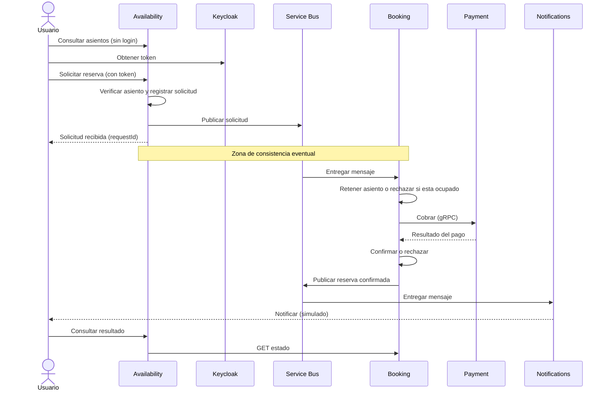
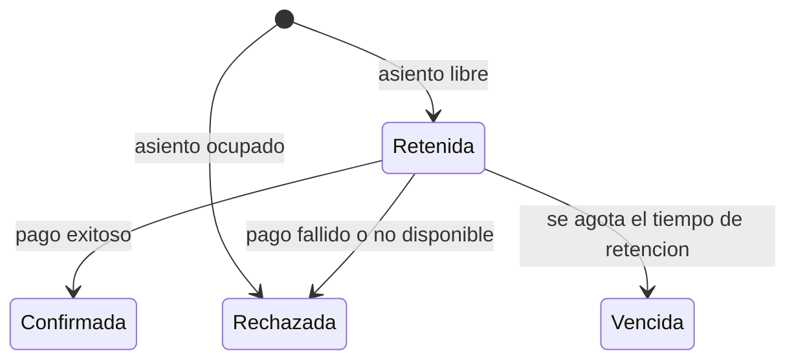
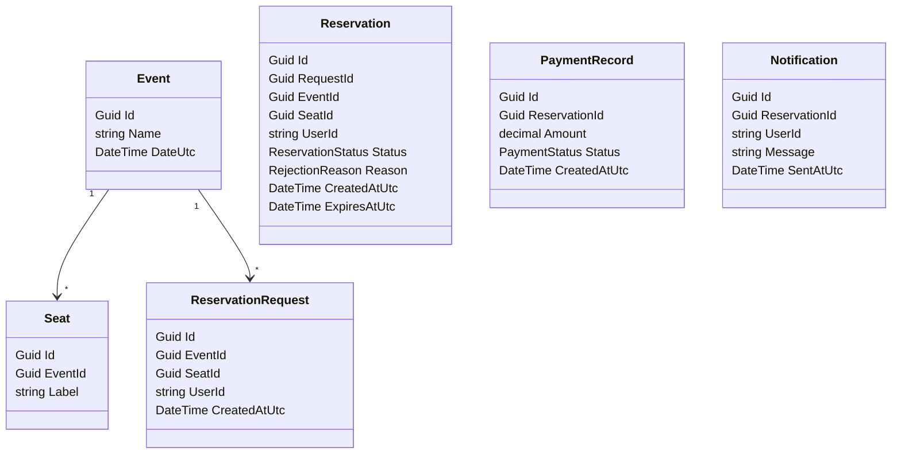

# Referencia del plan (fuente de verdad)

Todo lo que se documente o diagrame debe coincidir con este archivo.
Si algo del código necesita diferir, se actualiza acá primero.

## Servicios y puertos
| Servicio | Estilo | Puerto |
|---|---|---|
| Availability | Clean Architecture, dominio anémico | 5001 |
| Booking (REST) | N-Layer, dominio anémico | 5002 |
| Payment (gRPC) | N-Layer, dominio anémico | 5003 |
| Notifications | Worker que consume del broker | 5004 |
| Keycloak | Servidor de autorización | 8081 |
| PostgreSQL | Una base por servicio | 5432 |

Broker: Azure Service Bus, con dos colas:
`reservation-requests` (Availability a Booking) y `reservation-confirmed` (Booking a Notifications).

## Flujo de una reserva

## Estados de una reserva

Un asiento está ocupado mientras su reserva esté Retenida o Confirmada.

## Entidades por servicio (dominio anémico: solo datos)

- Availability: Event, Seat, ReservationRequest
- Booking: Reservation (estados: Retenida, Confirmada, Rechazada, Vencida; motivos: AsientoOcupado, PagoFallido, PagoNoDisponible)
- Payment: PaymentRecord (estados: Aprobado, Rechazado)
- Notifications: Notification

No hay relaciones entre entidades de servicios distintos: se vinculan solo por id (cada servicio tiene su propia base).

## Reglas de trabajo
1. Hacer `git pull` antes de empezar a trabajar.
2. Cada integrante trabaja en su área; los cambios a otra área se acuerdan antes.
3. Commits en español, con el formato `tipo: resumen`.
4. Cada integrante guarda sus prompts en `docs/prompts/nombre-apellido.md`.
5. Si una duda cambia el plan, se consulta antes de documentar algo distinto.