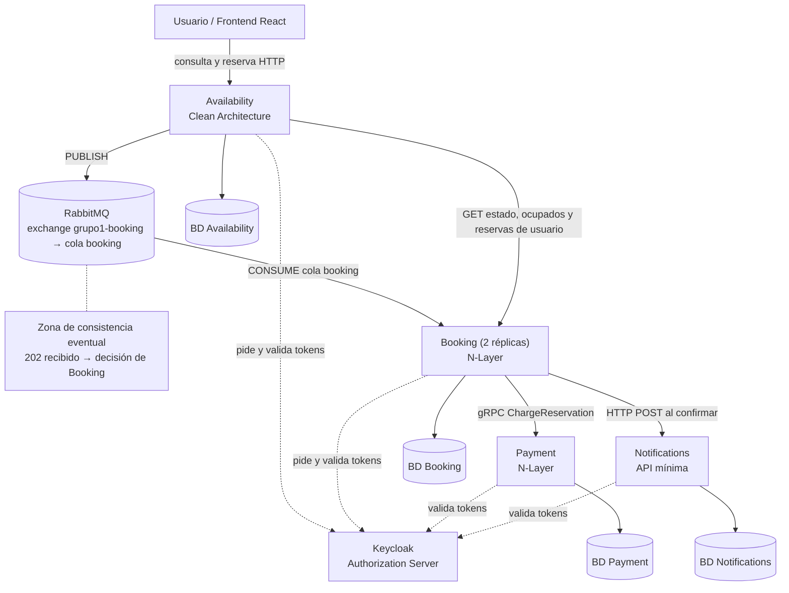

# Sistema de reserva de asientos

TP grupal de Programación IV (UTN), Grupo 1. Sistema de microservicios en .NET 10 y frontend en React 19 + TypeScript + Vite para reservar asientos de eventos, con consistencia eventual entre servicios.

> Todos los comandos de este documento se ejecutan desde la carpeta `seat-reservation`.

## Arquitectura



| Servicio | Estilo | Puerto local | Rol |
|---|---|---|---|
| **Availability** | Clean Architecture, dominio anémico | `5001` | API pública de entrada: consulta de eventos y asientos (con campo `occupied`), recibe solicitudes de reserva (`202 Accepted`), publica en RabbitMQ y consulta resultados e historial a Booking |
| **Booking** | N-Layer, dominio anémico | `5002` y `5003` (2 réplicas en Docker) | Consume de la cola `booking`, retiene el asiento, invoca el cobro por gRPC a Payment, confirma o rechaza la reserva, notifica por HTTP y vence reservas expiradas mediante un worker |
| **Payment** | N-Layer (gRPC), dominio anémico | Interno en Docker (`payment:8080`) / `5003` con `dotnet run` | Cobro simulado e idempotente por `ReservationId` (`ChargeReservation`) |
| **Notifications** | API mínima | `5004` | Registra y simula el envío de avisos cuando una reserva queda confirmada (idempotente por `ReservationId`) |
| **Keycloak** | Servidor de autorización (OIDC / OAuth2) | `8081` | Emite tokens JWT de usuarios (`seat-web`, login local o Google) y de servicios (*client credentials*) |
| **PostgreSQL 16** | Base de datos relacional | `5432` | Persistencia aislada con una base de datos independiente por microservicio (`availability`, `booking`, `payment`, `notifications`) |
| **RabbitMQ 4** | Broker de mensajes AMQP | `5672` (AMQP) y `15672` (panel web) | Exchange `grupo1-booking`, cola `booking`, Dead-Letter Exchange `grupo1-booking.dlx` y cola `booking.dead` |
| **Frontend** | React 19 + TypeScript + Vite | `3000` (Docker Nginx) / `5173` (Vite dev) | Interfaz web **SeatReserve** en carpeta `frontend/` |

El [diagrama general detallado](docs/diagrama-general.md) se mantiene por separado; este esquema resume las interacciones principales.

**Consistencia eventual:** Availability responde `"solicitud recibida"` (`202 Accepted`) apenas guarda el pedido y publica el mensaje en RabbitMQ, sin esperar el procesamiento de Booking. Entre ese instante y la decisión de Booking, el estado de la solicitud se informa como `EnProceso`.

**Estados de una reserva:** `EnProceso` (antes de que Booking la registre), `Retenida`, `Confirmada`, `Rechazada` (motivos: `AsientoOcupado`, `PagoFallido` o `PagoNoDisponible`) y `Vencida`. Un asiento se considera ocupado únicamente mientras tenga una reserva en estado `Retenida` o `Confirmada`.

---

## Endpoints y contratos de los microservicios

### 1. Availability (`http://localhost:5001`)
| Método | Ruta | Autenticación | Descripción |
|---|---|---|---|
| `GET` | `/events` | Pública | Lista todos los eventos disponibles ordenados por fecha (`id`, `name`, `dateUtc`). |
| `GET` | `/events/{eventId}/seats` | Pública | Lista todos los asientos del evento ordenados por fila y número con `occupied: true/false`. Responde `404` si el evento no existe o `503` si Booking no responde. |
| `POST` | `/reservations` | JWT de usuario | Recibe `{ eventId, seatId }`. Toma el `userId` del token (`preferred_username` o `sub`), registra la solicitud, publica en RabbitMQ y devuelve `202 Accepted` con `{ requestId, correlationId }`. Responde `404` si el asiento no existe o `503` si el broker no está disponible. |
| `GET` | `/reservations/{requestId}` | JWT de usuario | Devuelve `{ requestId, status, reason }` de una solicitud propia (`404` si no existe o pertenece a otro usuario; `EnProceso` si Booking aún no la procesó; `503` si Booking está caído). |
| `GET` | `/reservations/mine` | JWT de usuario | Devuelve el historial de reservas del usuario autenticado enriquecido con nombre/fecha del evento y etiqueta del asiento (`seatLabel`). |

### 2. Booking (`http://localhost:5002` y `5003`)
Todos sus endpoints HTTP son internos y exigen un token de servicio con política `AvailabilityOnly` (claim `azp = availability-service`):

| Método | Ruta | Descripción |
|---|---|---|
| `GET` | `/reservations/{requestId}` | Devuelve `{ requestId, reservationId, status, reason, expiresAtUtc }` o `404` si aún no fue procesada. |
| `GET` | `/events/{eventId}/occupied-seats` | Devuelve la lista de `Guid` de los asientos con reserva activa (`Retenida` o `Confirmada`). |
| `GET` | `/reservations?userId={userId}` | Devuelve todas las reservas de un usuario ordenadas desde la más reciente. |

Además, ejecuta dos servicios en segundo plano (`BackgroundService`):
* **`ReservationRequestConsumer`:** consume mensajes de la cola `booking` (`prefetchCount: 1`), procesa la reserva de forma idempotente y envía a `booking.dead` (`requeue: false`) cualquier mensaje con JSON ilegible.
* **`ReservationExpiryWorker`:** verifica cada 10 segundos las reservas en estado `Retenida` cuyo `ExpiresAtUtc` ya venció y las pasa a estado `Vencida`.

### 3. Payment (gRPC interno en `http://payment:8080`)
* **Método gRPC:** `PaymentProcessor.ChargeReservation` (definido en `src/Contracts/Protos/payment.proto`).
* **Autorización:** Política `BookingOnly` (exige claim `azp = booking-service`).
* **Comportamiento:** Convierte `AmountCents` a decimal, aprueba si el monto es `> 0` y `<= Payment:MaxAmount` (`100000` por defecto) y guarda el resultado de manera idempotente por `ReservationId`.

### 4. Notifications (`http://localhost:5004`)
| Método | Ruta | Autenticación | Descripción |
|---|---|---|---|
| `POST` | `/notifications` | Política `BookingOnly` (`booking-service`) | Registra y simula el envío de confirmación de reserva. Es idempotente por `ReservationId`. |
| `GET` | `/notifications` | Cualquier JWT válido | Devuelve las últimas 50 notificaciones enviadas ordenadas por `SentAtUtc` descendente (para pruebas y auditoría). |

---

## Variables de entorno y configuración

En Docker Compose todas las variables ya vienen preconfiguradas con valores de desarrollo local:

| Variable / Clave | Servicio(s) | Valor por defecto en Docker / Código | Descripción |
|---|---|---|---|
| `Auth__Authority` | Todos (.NET) | `http://keycloak:8080/realms/seat-reservation` | Emisor y autoridad OIDC para validar tokens JWT. |
| `Auth__RequireHttpsMetadata` | Todos (.NET) | `false` | Permite validar tokens por HTTP en entorno local. |
| `RabbitMq__Host` / `Port` / `User` / `Password` | Availability, Booking | `rabbitmq` / `5672` / `app` / `app` | Conexión al broker RabbitMQ. |
| `ConnectionStrings__<Servicio>` | Todos (.NET) | `Host=postgres;Port=5432;Database=<bd>;Username=app;Password=app` | Cadena de conexión a la base de datos propia de cada microservicio. |
| `ServiceAuth__TokenEndpoint` | Availability, Booking | `http://keycloak:8080/realms/seat-reservation/protocol/openid-connect/token` | Endpoint de Keycloak para obtener tokens *client credentials*. |
| `ServiceAuth__ClientId` / `ClientSecret` | Availability, Booking | `availability-service` / `booking-service` | Credenciales de servicio para llamadas salientes. |
| `Booking__BaseUrl` | Availability | `http://booking:8080/` | URL interna hacia Booking. |
| `Cors__AllowedOrigins` | Availability | `http://localhost:3000`, `http://localhost:5173` | Orígenes habilitados para peticiones desde el navegador (definido en `appsettings.json`). |
| `Payment__Address` | Booking | `http://payment:8080` | Dirección interna del servidor gRPC de Payment. |
| `Notifications__BaseUrl` | Booking | `http://notifications:8080/` | Dirección interna de Notifications (timeout de 3 segundos). |
| `Booking__HoldSeconds` | Booking | `120` (segundos) | Tiempo máximo que una reserva permanece `Retenida` antes de vencer. |
| `Booking__SeatPriceCents` | Booking | `500000` ($5.000,00) | Precio fijo simulado por asiento en centavos. |
| `Payment__MaxAmount` | Payment | `100000` ($100.000,00) | Monto máximo permitido para aprobar un pago simulado. |

---

## Requisitos

* Git, Docker Desktop (abierto) y PowerShell. El SDK de .NET 10 y Node.js 22+ solo hacen falta si se desea ejecutar algún componente fuera de contenedores.
* En Mac o Linux: PowerShell 7 (`pwsh` en lugar de `powershell`) para los scripts de prueba.
* No se necesita cuenta ni cadena de conexión de Azure Service Bus: RabbitMQ se ejecuta localmente en Docker.

## Cómo ejecutarlo

1. Clonar el repositorio y entrar a la carpeta `seat-reservation`.
2. Levantar el sistema completo con Docker. RabbitMQ, PostgreSQL, Keycloak, los 4 microservicios y el frontend se configuran automáticamente en la red local de contenedores. **No es necesario ejecutar scripts de secretos para usar Docker**.
3. Ejecutar los siguientes comandos desde la carpeta `seat-reservation` (la opción `--build` reconstruye las imágenes cuando hay cambios en el código):

```powershell
docker compose up -d --build
docker compose ps
```

4. Esperar uno o dos minutos (Keycloak importa el realm `seat-reservation` y los microservicios aplican sus migraciones de Entity Framework Core) y cargar las funciones de prueba en PowerShell. El primer comando habilita scripts solo en esa consola; el segundo lleva un punto y un espacio al principio:

```powershell
Set-ExecutionPolicy -Scope Process -ExecutionPolicy Bypass -Force
. ./scripts/funciones-prueba.ps1
```

* **Aplicación web (Frontend):** `http://localhost:3000`
* **Administración de contenedores:** Para pausar los servicios, ejecutar `docker compose stop`. Para detener y eliminar los contenedores conservando las bases de datos, utilizar `docker compose down`. Si se desea reiniciar completamente el entorno (borrando bases de datos y volúmenes de Keycloak), ejecutar `docker compose down -v`.

**Credenciales de desarrollo** (no hay datos reales):
* PostgreSQL (`localhost:5432`): `app` / `app`
* Panel de RabbitMQ (`http://localhost:15672`): `app` / `app`
* Panel de Keycloak (`http://localhost:8081`): `admin` / `admin`
* Usuarios de prueba: `usuario1` y `usuario2` (contraseña igual al nombre de usuario).

 * El email registrado se proporcionará por privado.
---

## Probar el flujo

Al iniciar, `DbSeeder` crea automáticamente **3 eventos de demostración** con IDs fijos:
1. **Recital Mercedes Sosa** (`11111111-1111-1111-1111-111111111111`): 20 asientos, del 1 al 10 (`A1` a `A10`) y del 11 al 20 (`B1` a `B10`). Es el evento predeterminado en `$EventoDemo` dentro de `funciones-prueba.ps1`.
2. **TecWeek 2026** (`22222222-2222-2222-2222-222222222222`): 24 asientos (filas `A`, `B` y `C` de 8 asientos).
3. **Teatro: Esperando a Godot** (`33333333-3333-3333-3333-333333333333`): 24 asientos (filas `A`, `B`, `C` y `D` de 6 asientos).

El endpoint `GET /events/{id}/seats` devuelve **todos** los asientos con el booleano `occupied`: `true` para ocupados y `false` para libres. Para detener temporalmente un servicio durante las pruebas, utilizar `docker compose stop <servicio>`, y para volver a iniciarlo, `docker compose start <servicio>`.

### Flujo feliz

```powershell
Eventos                                           # lista los 3 eventos de demostración
Asientos                                          # todos los asientos del evento demo, con occupied True/False (no pide token)
ReservarAutenticado (Seat 5) "usuario1"           # Confirmada
Asientos | Where-Object label -eq "A5"            # occupied: True después de confirmar
Invoke-RestMethod http://localhost:5004/notifications -Headers @{ Authorization = "Bearer $(Token 'usuario1')" }
```

Los logs de los servicios (`docker compose logs`) muestran líneas `AUDITORIA` con el mismo `CorrelationId` a lo largo de toda la cadena.

### Flujos de fallo

**Asiento ocupado:**

```powershell
ReservarAutenticado (Seat 5) "usuario2"           # Rechazada / AsientoOcupado
```

**Falta un componente: Payment caído:**

```powershell
docker compose stop payment
ReservarAutenticado (Seat 6) "usuario1"           # Rechazada / PagoNoDisponible (tras el deadline gRPC de 5 s)
(Asientos | Where-Object label -eq "A6").occupied # False: el asiento sigue libre
docker compose start payment
```

Pasados unos segundos, repetir con el mismo asiento: `Confirmada`. Si la primera llamada responde `Retenida`, consultar de nuevo con `Resultado $UltimaSolicitud "usuario1"`.

**Falta un componente: Booking caído:**

```powershell
docker compose stop booking
ReservarAutenticado (Seat 7) "usuario1"           # la solicitud se acepta (202), pero la consulta de estado responde 503
docker compose start booking
Start-Sleep -Seconds 20
Resultado $UltimaSolicitud "usuario1"             # Confirmada: RabbitMQ había persistido el mensaje en la cola booking
```

**Notifications caído:** Ejecutar `docker compose stop notifications` y reservar otro asiento. La reserva queda `Confirmada` igualmente (degradación elegante) y Booking registra el aviso fallido en su log.

**Autenticación y autorización entre servicios:**

```powershell
Invoke-RestMethod http://localhost:5002/reservations/$([guid]::NewGuid())                                                       # 401 sin token
Invoke-RestMethod http://localhost:5002/reservations/$([guid]::NewGuid()) -Headers @{ Authorization = "Bearer $(Token 'usuario1')" }   # 403: el token es de un usuario, no de availability-service
```

Para vaciar las reservas tomadas y repetir las pruebas desde cero:

```powershell
@'
TRUNCATE "Reservations";
'@ | docker compose exec -T postgres psql -U app -d booking
```

### Réplicas de Booking

En Docker corren dos réplicas (`replicas: 2`) que consumen de la misma cola `booking`: RabbitMQ entrega cada mensaje a una sola réplica (*competing consumers* con `prefetchCount: 1`). Para enviar varias reservas seguidas (asientos 11 a 14) y comprobar qué instancia procesó cada una:

```powershell
$h = @{ Authorization = "Bearer $(Token 'usuario1')" }
11..14 | ForEach-Object {
    $body = @{ eventId = $EventoDemo; seatId = (Seat $_) } | ConvertTo-Json
    Invoke-RestMethod -Method Post -Uri http://localhost:5001/reservations -Headers $h -ContentType "application/json" -Body $body | Out-Null
}
docker compose logs booking | Select-String "AUDITORIA inicio reserva"
```

Las líneas comienzan con `booking-1` o `booking-2`, repartidas entre ambas. Se puede detener una réplica (`docker stop <nombre>`; ver los nombres con `docker compose ps`) y el sistema sigue procesando con la otra.

**Importante:** cada integrante ejecuta su propio RabbitMQ local en Docker; así no se comparten mensajes entre máquinas. En una misma máquina, no iniciar Booking con `dotnet run` mientras están activas sus réplicas en Docker, porque competirían por la misma cola.

### Verificar RabbitMQ

Panel de administración: `http://localhost:15672` (`app` / `app`). En **Queues and Streams** deben figurar `booking` y `booking.dead`. En **Overview** se pueden observar las conexiones y consumidores. Para consultar las colas desde PowerShell:

```powershell
docker compose exec rabbitmq rabbitmqctl list_queues name messages consumers
```

---

## Problemas frecuentes

| Síntoma | Causa y solución |
|---|---|
| `"La ejecución de scripts está deshabilitada"` | Correr `Set-ExecutionPolicy -Scope Process -ExecutionPolicy Bypass -Force` en esa ventana de PowerShell. |
| `"No se reconoce el término Seat"` (o `Token`, `Asientos`) | Las funciones no están cargadas: recordar incluir el punto y el espacio inicial (`. ./scripts/funciones-prueba.ps1`) desde la carpeta `seat-reservation`. |
| RabbitMQ no está disponible o Availability responde `503` | Comprobar `docker compose ps`, revisar `docker compose logs rabbitmq availability booking` y volver a levantar con `docker compose up -d --build`. |
| Errores `401` con un token válido, o fallan los pedidos al principio | Keycloak todavía está importando el realm: esperar 1 a 2 minutos tras el arranque. |
| Se ve código viejo después de un `git pull` | Levantar siempre con `docker compose up -d --build` para reconstruir las imágenes de los contenedores. |
| Una reserva queda en `EnProceso` | Comprobar que las réplicas de Booking estén activas y consumiendo la cola `booking`; revisar sus logs con `docker compose logs booking`. |
| Cambió el archivo `seat-reservation-realm.json` y no se refleja | Keycloak solo importa el archivo cuando su volumen está vacío: ejecutar `docker compose down -v` y levantar de nuevo. |

---

## Decisiones de diseño

* **Una base de datos por servicio** (en un mismo motor PostgreSQL para simplicidad de desarrollo). Los servicios no comparten tablas y solo se vinculan por identificadores (`Guid`).
* **Un asiento solo puede tener una reserva activa:** lo garantiza el índice único parcial `ux_reservations_active_seat` en la base de datos de Booking (`WHERE "Status" IN ('Retenida', 'Confirmada')`). Es control de concurrencia optimista sin lock distribuido: quien llega segundo recibe una violación de unicidad en PostgreSQL y su solicitud se registra como `Rechazada` por `AsientoOcupado`.
* **Mensajería y Dead-Letter:** Availability publica en el exchange fanout `grupo1-booking` de RabbitMQ con confirmaciones de publicador activas; las dos réplicas de Booking comparten la cola durable `booking`. Los mensajes ilegibles se rechazan sin reencolar (`BasicNack` con `requeue: false`) y son derivados por RabbitMQ al Dead-Letter Exchange `grupo1-booking.dlx` hacia la cola `booking.dead`.
* **Idempotencia:** cada solicitud se procesa una sola vez en Booking (índice único `ux_reservations_request_id` por `RequestId`), el cobro se ejecuta una sola vez en Payment (índice único por `ReservationId`) y la notificación se registra una sola vez en Notifications (índice único por `ReservationId`). El mensaje se confirma (`BasicAck`) al broker recién después de completar el procesamiento.
* **Payment es una simulación:** aprueba si el monto es mayor que `0` y no supera `Payment:MaxAmount`. Booking establece un *deadline* gRPC de 5 segundos; si Payment no responde a tiempo o está caído, la reserva pasa a `Rechazada` por `PagoNoDisponible`.
* **Notifications por HTTP directo:** Booking notifica a Notifications mediante HTTP POST (`timeout` de 3 segundos) cuando una reserva queda `Confirmada`. Si Notifications falla o está apagado, la reserva permanece `Confirmada` y Booking registra una advertencia en el log (degradación elegante).
* **Autenticación y autorización:** Keycloak emite todos los tokens. Para solicitar o consultar reservas desde el cliente hace falta un JWT de usuario, y Availability extrae el `userId` directamente de los claims (`preferred_username` o `sub`), nunca del cuerpo HTTP. Entre microservicios se emplea el flujo *client credentials* verificando el claim `azp`: Booking acepta solo a `availability-service`; Payment y Notifications aceptan solo a `booking-service`.
* **Auditoría trazable:** cada servicio registra el inicio y el fin de su intervención con la palabra clave `AUDITORIA` y el mismo `CorrelationId`.
* **CORS:** Availability habilita peticiones desde los orígenes configurados en `Cors:AllowedOrigins` (`http://localhost:3000` y `http://localhost:5173`).
* **Infraestructura unificada en Docker:** un único `Dockerfile` parametrizado sirve a los cuatro servicios .NET. Keycloak tiene fijado su hostname (`http://localhost:8081`) mediante `KC_HOSTNAME` para garantizar que el emisor de los tokens (el claim `iss`) sea idéntico tanto si se valida desde dentro de la red de contenedores como desde llamadas externas del navegador.
---

## Autenticación con Google mediante Keycloak

**Google es opcional.** Sin configurarlo, el sistema funciona igual con `usuario1` y `usuario2`.

Google no está en el realm exportado porque su Client Secret no puede estar en el repositorio. Se carga en tiempo de ejecución con un script. Para activarlo:

1. Levantar el sistema y esperar a que Keycloak termine de iniciar.
2. Tener a mano el Client ID y el Client Secret (el equipo los entrega por privado).
3. Ejecutar:

   powershell -ExecutionPolicy Bypass -File ./scripts/configurar-google.ps1

4. Abrir http://localhost:3000 en incógnito y elegir "Google" con la cuenta de prueba que entrega el equipo.

La configuración queda solo en el volumen de Keycloak: si se ejecuta `docker compose down -v`, hay que volver a correr el script. No exportar el realm después de configurar Google.

**Guía paso a paso y pruebas:** [Integración Google OAuth con Keycloak](docs/autenticacion-google-keycloak.md).

---

## Limitaciones conocidas

* Los tokens JWT se validan por firma, emisor (`iss`) y vigencia (`exp`); la validación de audiencia (`aud`) está desactivada por simplificación de desarrollo.
* Si Notifications está caído al momento de confirmar una reserva, el aviso se registra en los logs de Booking pero no se reintenta más tarde (la solución de producción sería aplicar el patrón *Transactional Outbox*).
* Si una reserva vence exactamente mientras Payment está respondiendo con un cobro aprobado, la transición de estado no pisa el vencimiento, pero el cobro aprobado no dispara una compensación automática de reembolso.
* Keycloak y la validación de tokens operan sobre HTTP sin TLS exclusivamente para facilitar el entorno local de desarrollo.
* Availability persiste la `ReservationRequest` antes de publicar en RabbitMQ. Si la publicación falla, el usuario recibe `503` y puede reintentar; queda un registro de solicitud sin mensaje asociado, lo cual es inocuo.

---

## Estructura del repositorio

```text
seat-reservation/
├── docker-compose.yml
├── Dockerfile                          # Dockerfile multi-stage compartido por los 4 microservicios .NET
├── SeatReservation.sln                 # Solución con los 15 proyectos .NET 10
├── README.md                           # Este documento
├── infra/
│   ├── postgres/init.sql               # Creación de las 4 bases de datos
│   └── keycloak/seat-reservation-realm.json
├── scripts/
│   ├── configurar-google.ps1           # Alta interactiva del proveedor Google en Keycloak
│   ├── configurar-secretos.ps1         # User-secrets para ejecución fuera de Docker (dotnet run)
│   ├── funciones-prueba.ps1            # Funciones PowerShell para pruebas manuales E2E
│   ├── levantar-servicios.ps1          # Arranque local con dotnet run en ventanas separadas
│   └── tests_back_bloque_A.py          # Pruebas automatizadas de caja negra (Python)
├── docs/
│   ├── arq-availability.md
│   ├── arq-booking.md
│   ├── arq-notifications.md
│   ├── arq-payment.md
│   ├── autenticacion-google-keycloak.md
│   ├── diagrama-general.md
│   ├── documentacion-cambio-broker.md
│   ├── documentacion-frontend.md
│   ├── referencia-del-plan.md
│   ├── tabla-componentes.md
│   ├── prompts/                        # Historiales de prompts de los integrantes (Consigna 2)
│   └── testing/                        # Planes y evidencias de pruebas
│       ├── backend-tests.md
│       ├── frontend-tests.md
│       └── rabbitmq-tests.md
├── frontend/                           # Aplicación React 19 + TypeScript + Vite (Dockerfile y nginx.conf propios)
└── src/
    ├── Availability/                   # Clean Architecture: Domain, Application, Infrastructure, Api
    ├── Booking/                        # N-Layer: Entities, DataAccess, Business, Api
    ├── Payment/                        # N-Layer gRPC: Entities, DataAccess, Business, Grpc
    ├── Notifications/                  # Minimal API: Models, Data, Program.cs
    ├── Contracts/                      # Mensajes, BrokerTopology y Protos/payment.proto
    └── Shared/ServiceAuth/             # ClientCredentialsTokenProvider, ServiceTokenHandler y políticas JWT
```

---

## Documentación

La documentación técnica detallada del proyecto se encuentra organizada en los siguientes archivos:

* [Diagrama general de arquitectura](docs/diagrama-general.md)
* [Tabla de componentes (Consigna 1)](docs/tabla-componentes.md)
* [Arquitectura de Availability](docs/arq-availability.md)
* [Arquitectura de Booking](docs/arq-booking.md)
* [Arquitectura de Payment](docs/arq-payment.md)
* [Arquitectura de Notifications](docs/arq-notifications.md)
* [Documentación del cambio de broker a RabbitMQ](docs/documentacion-cambio-broker.md)
* [Integración de Google OAuth con Keycloak](docs/autenticacion-google-keycloak.md)
* [Documentación técnica del Frontend](docs/documentacion-frontend.md) y [README del Frontend](frontend/README.md)
* [Pruebas del Backend](docs/testing/backend-tests.md) · [Pruebas de RabbitMQ](docs/testing/rabbitmq-tests.md) · [Pruebas del Frontend](docs/testing/frontend-tests.md)
* [Referencia del plan inicial](docs/referencia-del-plan.md)
* [Historiales de prompts por integrante (Consigna 2)](docs/prompts/)

---

## Integrantes y responsabilidades

| Integrante | Responsabilidad / Historial de Prompts |
|---|---|
| Facundo Varela | Diagramas de arquitectura por API ([Prompts](docs/prompts/FacundoVarela-IsidroFerrero.md)) |
| Isidro Ferrero | Diagramas de arquitectura por API ([Prompts](docs/prompts/FacundoVarela-IsidroFerrero.md)) |
| Carla Andrea Colina Sosa | Testing: flujo feliz, fallos y evidencias ([Prompts](docs/prompts/CarlaAndreaColinaSosa.md)) |
| Joaquín Vega | Testing: flujo feliz, fallos y evidencias ([Prompts](docs/prompts/JoaquinVega.md)) |
| Diego Sebastián Ruiz Díaz | README general y documentación de Notifications ([Prompts](docs/prompts/DiegoRuizDiaz.md)) |
| Demian Cantarelli | Desarrollo e integración del sistema ([Prompts](docs/prompts/DemianCantarelli.md)) |
| Ignacio Kobylanski | Desarrollo e integración del sistema ([Prompts](docs/prompts/IgnacioKobylanski.md)) |
| María Agostina Elli | Desarrollo e integración del sistema ([Prompts](docs/prompts/MariaAgostinaElli.md)) |
| Matías Candia | Desarrollo e integración del sistema ([Prompts](docs/prompts/MatiasCandia.md)) |
| Nelly Burgos | Desarrollo e integración del sistema ([Prompts](docs/prompts/NellyBurgos.md)) |
| Nicolás Ferreyra | Desarrollo e integración del sistema ([Prompts](docs/prompts/NicolasFerreyra.md)) |