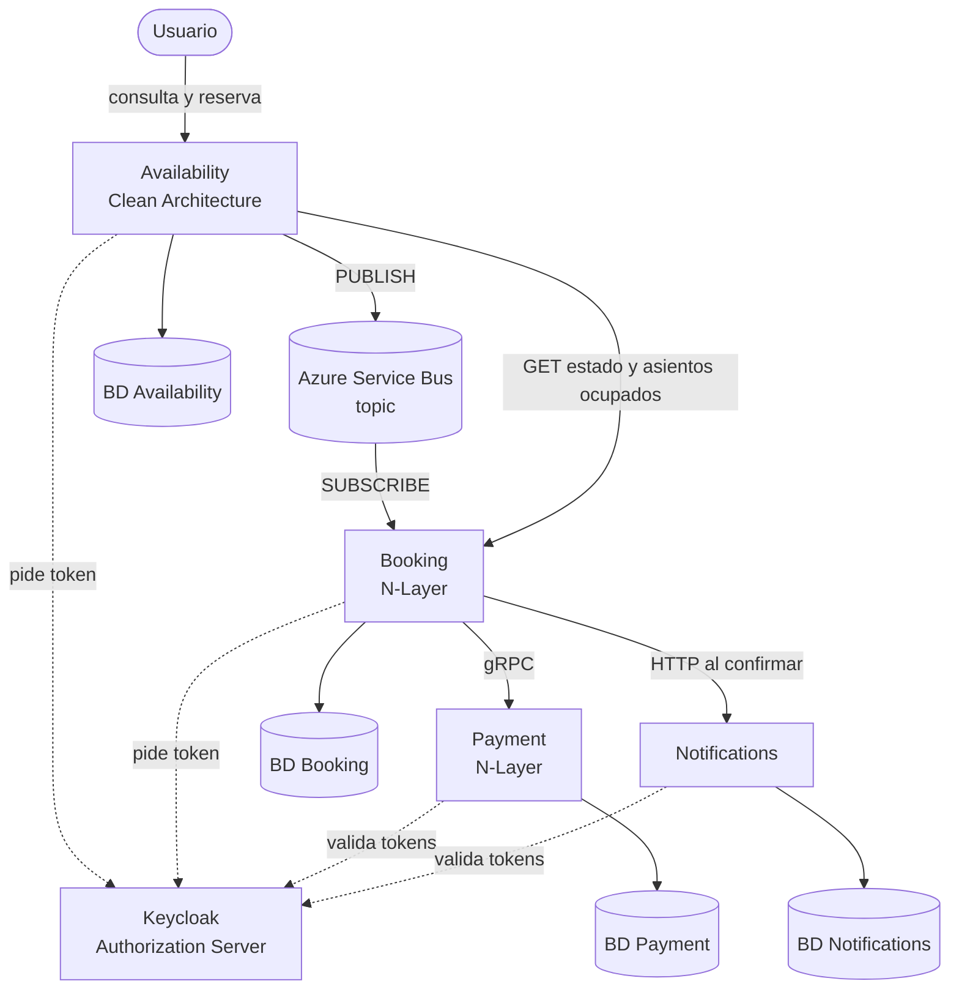

# Sistema de reserva de asientos

TP grupal de Programación IV (UTN), Grupo 1. Sistema de microservicios en .NET 10 para reservar asientos de eventos, con consistencia eventual entre servicios.

> Todos los comandos de este documento se ejecutan desde la carpeta `seat-reservation`.

## Arquitectura



| Servicio | Estilo | Puerto | Rol |
|---|---|---|---|
| Availability | Clean Architecture, dominio anémico | 5001 | Consulta de eventos y asientos libres; recibe la solicitud de reserva y la publica en el broker |
| Booking | N-Layer, dominio anémico | 5002 (y 5003 la segunda réplica en Docker) | Consume del broker, retiene el asiento, cobra a Payment y confirma o rechaza; vence reservas |
| Payment | N-Layer (gRPC), dominio anémico | 5003 (solo con `dotnet run`; en Docker es interno) | Cobro simulado e idempotente |
| Notifications | API mínima | 5004 | Aviso (simulado) cuando una reserva queda confirmada |
| Keycloak | Servidor de autorización | 8081 | Emite los tokens de usuarios y de servicios |
| PostgreSQL | Una base por servicio | 5432 | Persistencia |
| Azure Service Bus | Topic `grupo1-booking-topic`, suscripción `booking` | - | Broker entre Availability y Booking |
| Frontend | TypeScript, en desarrollo | - | Carpeta `src/Frontend` |

**Consistencia eventual.** Availability responde "solicitud recibida" (202) apenas publica el mensaje, sin esperar el resultado. Entre ese momento y la decisión de Booking, el estado de la solicitud se ve como `EnProceso`.

**Estados de una reserva:** Retenida, Confirmada, Rechazada (asiento ocupado, pago fallido o pago no disponible) y Vencida. Un asiento está ocupado mientras su reserva esté Retenida o Confirmada.

## Requisitos

- Git, Docker Desktop (abierto) y PowerShell. El SDK de .NET 10 solo hace falta para ejecutar sin contenedores de aplicación.
- En Mac o Linux: PowerShell 7 (`pwsh` en lugar de `powershell`) y definir `USER_SECRETS_DIR=$HOME/.microsoft/usersecrets` antes de usar Docker.
- El connection string de Azure Service Bus del grupo. **No está en el repositorio**: se guarda en los *user-secrets* de .NET.

## Cómo ejecutarlo

1. Clonar el repositorio y entrar a la carpeta `seat-reservation`.
2. Guardar los secretos (**una sola vez por máquina**). El script pide el connection string (no se ve al escribir) y lo guarda en los user-secrets, fuera del repositorio; también guarda los secretos de los clientes de Keycloak, que lee del realm exportado. No necesita el SDK de .NET:

   ```powershell
   powershell -ExecutionPolicy Bypass -File ./scripts/configurar-secretos.ps1
   ```

3. Elegir cómo ejecutar:

   **A. Todo en contenedores (recomendado).** Usar siempre `--build`: si no hubo cambios es inmediato, y evita quedarse con una versión vieja después de un `git pull`. La primera vez tarda varios minutos en compilar:

   ```powershell
   docker compose up -d --build
   docker compose ps
   ```

   **B. Servicios con `dotnet run`** (requiere el SDK de .NET 10; la infraestructura sigue en Docker). Abre una ventana por servicio:

   ```powershell
   docker compose up -d postgres keycloak
   powershell -ExecutionPolicy Bypass -File ./scripts/levantar-servicios.ps1
   ```

4. Esperar uno o dos minutos (Keycloak carga solo el realm `seat-reservation` con los clientes y los usuarios de prueba) y cargar las funciones de prueba. El primer comando habilita scripts solo en esa ventana; el segundo tiene un punto y un espacio al principio:

   ```powershell
   Set-ExecutionPolicy -Scope Process -ExecutionPolicy Bypass -Force
   . ./scripts/funciones-prueba.ps1
   ```

No ejecutar A y B a la vez: usan los mismos puertos. Para pausar: `docker compose stop`. Para apagar conservando las bases: `docker compose down`. Para borrar además las bases y la configuración de Keycloak y empezar de cero: `docker compose down -v`.

**Credenciales de desarrollo** (no hay datos reales): PostgreSQL `app` / `app`; panel de Keycloak (`http://localhost:8081`) `admin` / `admin`; usuarios de prueba `usuario1` y `usuario2`, con la contraseña igual al nombre de usuario.

## Verificar que quedó bien

Estas comprobaciones no mandan ni reciben mensajes del broker:

```powershell
Get-Command Seat, Asientos, Token, Resultado, ReservarAutenticado | Select-Object Name, CommandType   # cinco funciones
(Token "usuario1").Substring(0, 10)                                                                    # eyJhbGciOi
(Asientos).Count                                                                                       # asientos libres (20 si no hay reservas)
Invoke-RestMethod -Method Post -Uri http://localhost:5001/reservations -ContentType "application/json" -Body (@{ eventId = $EventoDemo; seatId = (Seat 1) } | ConvertTo-Json)   # error 401: reservar exige token
```
La lista completa de casos de prueba, con comando y resultado esperado, está en `docs/pruebas.md`.

## Probar el flujo

Hay 20 asientos, del 1 al 10 (A1 a A10) y del 11 al 20 (B1 a B10). Para apagar un servicio: en Docker, `docker compose stop <servicio>` (y `start` para volver); con `dotnet run`, cerrar su ventana.

### Flujo feliz

```powershell
Asientos                                          # asientos libres (no pide token)
ReservarAutenticado (Seat 5) "usuario1"           # Confirmada
Asientos                                          # False: el asiento 5 ya no figura libre
Invoke-RestMethod http://localhost:5004/notifications -Headers @{ Authorization = "Bearer $(Token 'usuario1')" }
```

Los logs de los servicios (`docker compose logs`) muestran líneas `AUDITORIA` con el mismo `CorrelationId` a lo largo de toda la cadena.

### Flujos de fallo

**Asiento ocupado:**

```powershell
ReservarAutenticado (Seat 5) "usuario2"           # Rechazada / AsientoOcupado
```

**Falta un componente: Payment caído.**

```powershell
docker compose stop payment
ReservarAutenticado (Seat 6) "usuario1"           # Rechazada / PagoNoDisponible (puede tardar unos segundos)
(Asientos).label -contains "A6"                   # True: el asiento sigue libre
docker compose start payment
```

Pasados unos segundos, repetir con el mismo asiento: `Confirmada`. Si la primera llamada responde `Retenida`, consultar de nuevo con `Resultado $UltimaSolicitud "usuario1"`.

**Falta un componente: Booking caído.**

```powershell
docker compose stop booking
ReservarAutenticado (Seat 7) "usuario1"           # la solicitud se acepta, pero la consulta responde 503
docker compose start booking
Start-Sleep -Seconds 20
Resultado $UltimaSolicitud "usuario1"             # Confirmada: el broker había guardado el mensaje
```

**Notifications caído:** `docker compose stop notifications` y reservar otro asiento. La reserva queda `Confirmada` igual y Booking registra el aviso fallido en su log.

**Autenticación:**

```powershell
Invoke-RestMethod http://localhost:5002/reservations/$([guid]::NewGuid())                                                       # 401 sin token
Invoke-RestMethod http://localhost:5002/reservations/$([guid]::NewGuid()) -Headers @{ Authorization = "Bearer $(Token 'usuario1')" }   # 403: el token es de un usuario, no de availability-service
```

Para liberar todos los asientos y repetir las pruebas:

```powershell
@'
TRUNCATE "Reservations";
'@ | docker compose exec -T postgres psql -U app -d booking
```

### Réplicas de Booking

En Docker corren dos réplicas que leen la misma suscripción: el broker entrega cada mensaje a una sola. Mandar varias reservas seguidas (usan los asientos 11 a 14) y ver quién procesó cada una:

```powershell
$h = @{ Authorization = "Bearer $(Token 'usuario1')" }
11..14 | ForEach-Object {
    $body = @{ eventId = $EventoDemo; seatId = (Seat $_) } | ConvertTo-Json
    Invoke-RestMethod -Method Post -Uri http://localhost:5001/reservations -Headers $h -ContentType "application/json" -Body $body | Out-Null
}
docker compose logs booking | Select-String "AUDITORIA inicio reserva"
```

Las líneas empiezan con `booking-1` o `booking-2`, repartidas entre ambas. Se puede apagar una réplica (`docker stop <nombre>`; ver los nombres con `docker compose ps`) y el sistema sigue procesando con la otra.

**Importante:** si dos personas tienen Booking conectado al mismo topic al mismo tiempo (en máquinas distintas), el broker reparte los mensajes entre ellos y la reserva de uno la procesa el otro. Mientras se evalúa, que haya un solo Booking por máquina encendido (o las réplicas de una misma).

## Problemas frecuentes

| Síntoma | Causa y solución |
|---|---|
| "La ejecución de scripts está deshabilitada" | Correr `Set-ExecutionPolicy -Scope Process -ExecutionPolicy Bypass -Force` en esa ventana |
| "No se reconoce el término Seat" (o `Token`, `Asientos`) | Las funciones no están cargadas: falta el punto y el espacio (`. ./scripts/funciones-prueba.ps1`) o se está en otra carpeta |
| `Falta ServiceBus:ConnectionString` o Booking se reinicia en bucle | No se corrió el script de secretos, o se corrió en otra máquina |
| Errores 401 con un token válido, o fallan los pedidos al principio | Keycloak todavía está cargando el realm: esperar 2 minutos |
| Se ve código viejo después de un `git pull` | Levantar siempre con `docker compose up -d --build` |
| Una reserva queda en `EnProceso` para siempre | Hay otro Booking conectado al mismo topic (por ejemplo, el de otra persona) |
| Cambió el realm de Keycloak y no se nota | Keycloak solo importa el archivo con el volumen vacío: `docker compose down -v` y levantar de nuevo |

## Decisiones de diseño

- **Una base de datos por servicio** (en un mismo servidor PostgreSQL para desarrollo). Los servicios solo se vinculan por identificadores.
- **Un asiento solo puede tener una reserva activa:** lo garantiza un índice único parcial en la base de Booking. Es control de concurrencia optimista, sin lock distribuido: el que llega segundo recibe una violación de unicidad y se rechaza por asiento ocupado.
- **Idempotencia:** cada solicitud se procesa una sola vez (índice único por `RequestId`) y el cobro se hace una sola vez por reserva. El mensaje se confirma al broker solo después de procesarlo.
- **Payment es una simulación:** aprueba si el monto es mayor que 0 y no supera un máximo configurable. Booking le pone un plazo de 5 segundos; si no responde, la reserva se rechaza por "pago no disponible".
- **Notifications** no figura en el diagrama oficial (punto h): Booking la llama por HTTP solo al confirmar, sin pasar por el broker. Si Notifications falla, la reserva se confirma igual (degradación elegante).
- **Autenticación (punto e):** Keycloak emite los tokens. Para reservar hace falta el token de un usuario y Availability toma el usuario del token, no del pedido. Entre servicios se usa el flujo *client credentials*: Booking acepta solo a `availability-service`; Payment y Notifications aceptan solo a `booking-service`.
- **Auditoría (punto f):** cada servicio registra el inicio y el fin de su parte de la cadena con un `CorrelationId` común.
- **Secretos:** el connection string vive solo en los *user-secrets* de .NET, fuera del repositorio. En Docker, esa carpeta se monta en solo lectura en Availability y Booking. Los secretos de los clientes de Keycloak son credenciales de desarrollo y figuran en el realm exportado.
- **Docker:** un único `Dockerfile` sirve a los cuatro servicios, y Booking corre con dos réplicas. Keycloak tiene fijado su hostname (`http://localhost:8081`) para que el emisor de los tokens sea el mismo dentro y fuera de la red de contenedores.
- **CORS:** Availability permite pedidos desde los orígenes configurados en `Cors:AllowedOrigins`, para el frontend.

## Limitaciones conocidas

- Los tokens se validan por firma, emisor y vigencia; no se valida la audiencia.
El login con un proveedor de identidad externo que muestra el diagrama se está incorporando; ver el estado en `docs/`.
- Si Notifications está caído justo al confirmar, ese aviso se pierde (no hay reintento; la solución sería un patrón Outbox).
- Si una reserva vence mientras Payment responde, el cobro aprobado no se compensa con un reembolso.
- Keycloak y la validación de tokens funcionan sin HTTPS: es una configuración solo para desarrollo local.
- La solicitud se guarda en Availability antes de publicarse. Si la publicación falla, queda registrada sin mensaje y el usuario puede reintentar.

## Estructura del repositorio

```text
seat-reservation/
├── docker-compose.yml
├── Dockerfile                # compartido por los cuatro servicios
├── SeatReservation.sln
├── infra/
│   ├── postgres/init.sql     # una base por servicio
│   └── keycloak/seat-reservation-realm.json
├── scripts/                  # secretos, ejecución y funciones de prueba
├── docs/                     # documentación del grupo y casos de prueba
└── src/
    ├── Availability/         # Domain, Application, Infrastructure, Api
    ├── Booking/              # Api, Business, DataAccess, Entities
    ├── Payment/              # Grpc, Business, DataAccess, Entities
    ├── Notifications/        # API mínima
    ├── Contracts/            # mensaje del broker y contrato gRPC
    ├── Shared/ServiceAuth/   # token entre servicios y validación con Keycloak
    └── Frontend/             # TypeScript, en desarrollo
```

## Documentación

En `docs/`: tabla de componentes, diagrama general, diagramas de arquitectura de cada API, casos de prueba (`pruebas.md`), decisiones de diseño y los historiales de prompts de cada integrante (`docs/prompts/`).

