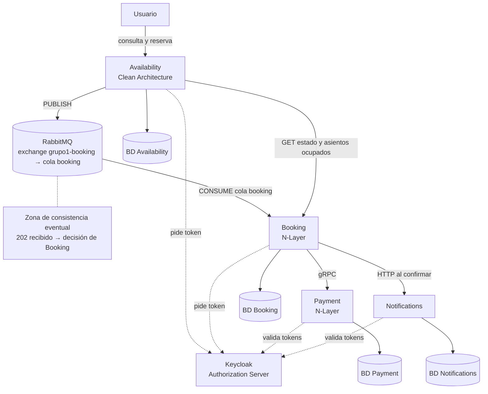

# Sistema de reserva de asientos

TP grupal de Programación IV (UTN), Grupo 1. Sistema de microservicios en .NET 10 para reservar asientos de eventos, con consistencia eventual entre servicios.

> Todos los comandos de este documento se ejecutan desde la carpeta `seat-reservation`.

## Arquitectura



|Servicio|Estilo|Puerto|Rol|
|-|-|-|-|
|Availability|Clean Architecture, dominio anémico|5001|Consulta de eventos y asientos (con campo `occupied`); recibe la solicitud de reserva y la publica en el broker|
|Booking|N-Layer, dominio anémico|5002 (y 5003 la segunda réplica en Docker)|Consume del broker, retiene el asiento, cobra a Payment y confirma o rechaza; vence reservas|
|Payment|N-Layer (gRPC), dominio anémico|5003 (solo con `dotnet run`; en Docker es interno)|Cobro simulado e idempotente|
|Notifications|API mínima|5004|Aviso (simulado) cuando una reserva queda confirmada|
|Keycloak|Servidor de autorización|8081|Emite los tokens de usuarios y de servicios|
|PostgreSQL|Una base por servicio|5432|Persistencia|
|RabbitMQ|Exchange `grupo1-booking`, cola `booking` y cola `booking.dead`|15672 (panel)|Broker local en Docker entre Availability y Booking|
|Frontend|React + TypeScript + Vite, en desarrollo|3000 (Docker)|Carpeta `frontend/`|

El [diagrama general detallado](docs/diagrama-general.md) se mantiene por separado; este esquema resume las interacciones principales.

**Consistencia eventual.** Availability responde "solicitud recibida" (202) apenas publica el mensaje, sin esperar el resultado. Entre ese momento y la decisión de Booking, el estado de la solicitud se ve como `EnProceso`.

**Estados de una reserva:** Retenida, Confirmada, Rechazada (asiento ocupado, pago fallido o pago no disponible) y Vencida. Un asiento está ocupado mientras su reserva esté Retenida o Confirmada.

## Requisitos

* Git, Docker Desktop (abierto) y PowerShell. El SDK de .NET 10 solo hace falta para ejecutar sin contenedores de aplicación.
* En Mac o Linux: PowerShell 7 (`pwsh` en lugar de `powershell`) para los scripts de prueba.
* No se necesita cuenta ni cadena de conexión de Azure Service Bus: RabbitMQ se ejecuta localmente en Docker.

## Cómo ejecutarlo

1. Clonar el repositorio y entrar a la carpeta `seat-reservation`.
2. Levantar el sistema completo con Docker. RabbitMQ, PostgreSQL, Keycloak y los microservicios se configuran en la red local de contenedores. **No es necesario ejecutar el script de configuración de Azure ni cargar un connection string**.

3\. Levantar el sistema con Docker: ejecutar los siguientes comandos desde la carpeta seat-reservation. La opción --build permite reconstruir las imágenes cuando hay cambios en el código.```powershell
   docker compose up -d --build
   docker compose ps
   ```

4. Esperar uno o dos minutos (Keycloak carga solo el realm `seat-reservation` con los clientes y los usuarios de prueba) y cargar las funciones de prueba. El primer comando habilita scripts solo en esa ventana; el segundo tiene un punto y un espacio al principio:

```powershell
   Set-ExecutionPolicy -Scope Process -ExecutionPolicy Bypass -Force
   . ./scripts/funciones-prueba.ps1
   ```

Administración de contenedores: Para pausar los servicios, ejecutar docker compose stop. Para detener y eliminar los contenedores conservando las bases de datos, utilizar docker compose down. Si se desea reiniciar completamente el entorno, incluyendo las bases de datos y la configuración persistida de Keycloak, ejecutar docker compose down -v.

**Credenciales de desarrollo** (no hay datos reales): PostgreSQL `app` / `app`; panel de RabbitMQ (`http://localhost:15672`) `app` / `app`; panel de Keycloak (`http://localhost:8081`) `admin` / `admin`; usuarios de prueba `usuario1` y `usuario2`, con la contraseña igual al nombre de usuario.

## Probar el flujo

El evento de demostración inicial tiene 20 asientos, del 1 al 10 (A1 a A10) y del 11 al 20 (B1 a B10). El endpoint `GET /events/{id}/seats` devuelve **todos** los asientos con `occupied`: `true` para ocupados y `false` para libres.Para detener temporalmente un servicio, utilizar docker compose stop <servicio>. Para volver a iniciarlo, ejecutar docker compose start <servicio>.Flujo feliz

```powershell
Asientos                                          # todos los asientos, con occupied True/False (no pide token)
ReservarAutenticado (Seat 5) "usuario1"           # Confirmada
Asientos | Where-Object label -eq "A5"            # occupied: True después de confirmar
Invoke-RestMethod http://localhost:5004/notifications -Headers @{ Authorization = "Bearer $(Token 'usuario1')" }
```

Los logs de los servicios (`docker compose logs`) muestran líneas `AUDITORIA` con el mismo `CorrelationId` a lo largo de toda la cadena.

### Flujos de fallo

**Asiento ocupado:**

```powershell
ReservarAutenticado (Seat 5) "usuario2"           # Rechazada / AsientoOcupado
```

**Falta un componente: Payment caído.**

```powershell
docker compose stop payment
ReservarAutenticado (Seat 6) "usuario1"           # Rechazada / PagoNoDisponible (puede tardar unos segundos)
(Asientos | Where-Object label -eq "A6").occupied  # False: el asiento sigue libre
docker compose start payment
```

Pasados unos segundos, repetir con el mismo asiento: `Confirmada`. Si la primera llamada responde `Retenida`, consultar de nuevo con `Resultado $UltimaSolicitud "usuario1"`.

**Falta un componente: Booking caído.**

```powershell
docker compose stop booking
ReservarAutenticado (Seat 7) "usuario1"           # la solicitud se acepta, pero la consulta responde 503
docker compose start booking
Start-Sleep -Seconds 20
Resultado $UltimaSolicitud "usuario1"             # Confirmada: el broker había guardado el mensaje
```

**Notifications caído:** `docker compose stop notifications` y reservar otro asiento. La reserva queda `Confirmada` igual y Booking registra el aviso fallido en su log.

**Autenticación:**

```powershell
Invoke-RestMethod http://localhost:5002/reservations/$(\[guid]::NewGuid())                                                       # 401 sin token
Invoke-RestMethod http://localhost:5002/reservations/$(\[guid]::NewGuid()) -Headers @{ Authorization = "Bearer $(Token 'usuario1')" }   # 403: el token es de un usuario, no de availability-service
```

Para liberar todos los asientos y repetir las pruebas:

```powershell
@'
TRUNCATE "Reservations";
'@ | docker compose exec -T postgres psql -U app -d booking
```

### Réplicas de Booking

En Docker corren dos réplicas que consumen la misma cola `booking`: el broker entrega cada mensaje a una sola. Mandar varias reservas seguidas (usan los asientos 11 a 14) y ver quién procesó cada una:

```powershell
$h = @{ Authorization = "Bearer $(Token 'usuario1')" }
11..14 | ForEach-Object {
    $body = @{ eventId = $EventoDemo; seatId = (Seat $_) } | ConvertTo-Json
    Invoke-RestMethod -Method Post -Uri http://localhost:5001/reservations -Headers $h -ContentType "application/json" -Body $body | Out-Null
}
docker compose logs booking | Select-String "AUDITORIA inicio reserva"
```

Las líneas empiezan con `booking-1` o `booking-2`, repartidas entre ambas. Se puede apagar una réplica (`docker stop <nombre>`; ver los nombres con `docker compose ps`) y el sistema sigue procesando con la otra.

**Importante:** cada integrante ejecuta su propio RabbitMQ local en Docker; así no se comparten mensajes entre máquinas. En una misma máquina, no iniciar Booking con `dotnet run` mientras están activas sus réplicas en Docker, porque competirían por la misma cola.

### Verificar RabbitMQ

Panel de administración: `http://localhost:15672` (`app` / `app`). En **Queues and Streams** deben figurar `booking` y `booking.dead`. En **Overview** se pueden observar las conexiones y consumidores. Para consultar las colas desde PowerShell:

```powershell
docker compose exec rabbitmq rabbitmqctl list_queues name messages consumers
```

## Problemas frecuentes

|Síntoma|Causa y solución|
|-|-|
|"La ejecución de scripts está deshabilitada"|Correr `Set-ExecutionPolicy -Scope Process -ExecutionPolicy Bypass -Force` en esa ventana|
|"No se reconoce el término Seat" (o `Token`, `Asientos`)|Las funciones no están cargadas: falta el punto y el espacio (`. ./scripts/funciones-prueba.ps1`) o se está en otra carpeta|
|RabbitMQ no está disponible o Availability responde 503|Comprobar `docker compose ps`, revisar `docker compose logs rabbitmq availability booking` y volver a levantar con `docker compose up -d --build`|
|Errores 401 con un token válido, o fallan los pedidos al principio|Keycloak todavía está cargando el realm: esperar 2 minutos|
|Se ve código viejo después de un `git pull`|Levantar siempre con `docker compose up -d --build`|
|Una reserva queda en `EnProceso`|Comprobar que las réplicas de Booking estén activas y consumiendo la cola `booking`; revisar sus logs|
|Cambió el realm de Keycloak y no se nota|Keycloak solo importa el archivo con el volumen vacío: `docker compose down -v` y levantar de nuevo|

## Decisiones de diseño

* **Una base de datos por servicio** (en un mismo servidor PostgreSQL para desarrollo). Los servicios solo se vinculan por identificadores.
* **Un asiento solo puede tener una reserva activa:** lo garantiza un índice único parcial en la base de Booking. Es control de concurrencia optimista, sin lock distribuido: el que llega segundo recibe una violación de unicidad y se rechaza por asiento ocupado.
* **Mensajería:** Availability publica en el exchange `grupo1-booking` de RabbitMQ; las dos réplicas de Booking comparten la cola `booking`. Se configura además la cola booking.dead para recibir mensajes derivados mediante la política de dead-letter.
* **Idempotencia:** cada solicitud se procesa una sola vez (índice único por `RequestId`) y el cobro se hace una sola vez por reserva. El mensaje se confirma al broker solo después de procesarlo.
* **Payment es una simulación:** aprueba si el monto es mayor que 0 y no supera un máximo configurable. Booking le pone un plazo de 5 segundos; si no responde, la reserva se rechaza por "pago no disponible".
* **Notifications:** Booking se comunica directamente con el servicio de notificaciones mediante HTTP cuando una reserva queda confirmada, sin utilizar RabbitMQ. Si Notifications no está disponible, la reserva se confirma igualmente, evitando que una falla en el servicio de notificaciones interrumpa el proceso principal.
* **Autenticación :** Keycloak emite los tokens. Para reservar hace falta el token de un usuario y Availability toma el usuario del token, no del pedido. Entre servicios se usa el flujo *client credentials*: Booking acepta solo a `availability-service`; Payment y Notifications aceptan solo a `booking-service`.
* **Auditoría :** cada servicio registra el inicio y el fin de su parte de la cadena con un `CorrelationId` común.
* **Broker local:** RabbitMQ se ejecuta en Docker; no se requiere connection string ni *user-secrets* de Azure. Las credenciales `app` / `app` son exclusivamente de desarrollo. Los secretos de los clientes de Keycloak son credenciales de desarrollo y figuran en el realm exportado.
* **Docker:** un único `Dockerfile` sirve a los cuatro servicios, y Booking corre con dos réplicas. Keycloak tiene fijado su hostname (`http://localhost:8081`) para que el emisor de los tokens sea el mismo dentro y fuera de la red de contenedores.
* **CORS:** Availability permite pedidos desde los orígenes configurados en `Cors:AllowedOrigins`, para el frontend.

## Autenticación con Google mediante Keycloak

El flujo de autenticación del sistema admite **dos modalidades de inicio de sesión**: usuarios locales de prueba de Keycloak (`usuario1` y `usuario2`) y autenticación federada con **Google (OpenID Connect)** a través de Keycloak. En ambos casos, Keycloak emite los tokens que valida el backend. La autenticación entre microservicios continúa usando *client credentials*.

1. El frontend redirige al usuario al realm `seat-reservation` de Keycloak.
2. El usuario selecciona Google y se autentica con su cuenta.
3. Google devuelve el control a Keycloak, que emite los tokens para el cliente web.
4. El frontend presenta el access token de Keycloak al llamar a los endpoints protegidos de Availability.

La configuración requiere un cliente OAuth de tipo *Web application* en Google Cloud y un proveedor Google en Keycloak. La **Redirect URI debe copiarse desde Keycloak** y coincidir exactamente con la autorizada en Google. El `Client Secret` de Google **no debe incluirse en Git, en el frontend ni en la documentación**.

**Guía de configuración y pruebas:** [Integración Google OAuth con Keycloak](docs/autenticacion-google-keycloak.md). Las verificaciones abarcan el login con Google, el acceso autenticado a Availability y la continuidad de los usuarios locales de prueba.

## Limitaciones conocidas

* Los tokens se validan por firma, emisor y vigencia; no se valida la audiencia.
* Si Notifications está caído justo al confirmar, ese aviso se pierde (no hay reintento; la solución sería un patrón Outbox).
* Si una reserva vence mientras Payment responde, el cobro aprobado no se compensa con un reembolso.
* Keycloak y la validación de tokens funcionan sin HTTPS: es una configuración solo para desarrollo local.
* La solicitud se guarda en Availability antes de publicarse. Si la publicación falla, queda registrada sin mensaje y el usuario puede reintentar.

## Estructura del repositorio

```text
seat-reservation/
├── docker-compose.yml
├── Dockerfile                # compartido por los cuatro servicios
├── SeatReservation.sln
├── infra/
│   ├── postgres/init.sql     # una base por servicio
│   └── keycloak/seat-reservation-realm.json
├── scripts/                  # secretos, ejecución y funciones de prueba
├── docs/                     # arquitectura, diagramas y prompts
├── frontend/                 # React + TypeScript + Vite (Dockerfile propio)
└── src/
    ├── Availability/         # Domain, Application, Infrastructure, Api
    ├── Booking/              # Api, Business, DataAccess, Entities
    ├── Payment/              # Grpc, Business, DataAccess, Entities
    ├── Notifications/        # API mínima
    ├── Contracts/            # mensaje del broker y contrato gRPC
    └── Shared/ServiceAuth/   # token entre servicios y validación con Keycloak
```

## Documentación

La documentación técnica del proyecto se encuentra organizada en los siguientes archivos:

* [Diagrama general de arquitectura](docs/diagrama-general.md)
* [Tabla de componentes](docs/tabla-componentes.md)
* [Arquitectura de Availability](docs/arq-availability.md)
* [Arquitectura de Booking](docs/arq-booking.md)
* [Arquitectura de Payment](docs/arq-payment.md)
* [Arquitectura de Notifications](docs/arq-notifications.md)
* [Integración de Google OAuth con Keycloak](docs/autenticacion-google-keycloak.md)
* [Historiales de prompts](docs/prompts/)

Las pruebas reproducibles de los flujos principales están descritas en este README. La documentación específica del frontend se mantiene por separado en `frontend/README.md`.

## Integrantes y responsabilidades

|Integrante|Responsabilidad|
|-|-|
|Facundo Varela|Diagramas de arquitectura por API|
|Isidro Ferrero|Diagramas de arquitectura por API|
|Carla Andrea Colina Sosa|Testing: flujo feliz, fallos y evidencias|
|Joaquin Vega|Testing: flujo feliz, fallos y evidencias|
|Diego Sebastian Ruiz Diaz|README general y documentación de Notifications|
|Nicolas Adrian Ferreyra|README general y documentación de Notifications|
|Demián Nazareno Cantarelli| tabla de componentes y documentación complementaria -> README frontend|
|Matias Candia|Diagrama general y documentación complementaria|
|Ignacio Kobylanski|Desarrollo de código|
|Maria Agostina Elli Valledor|Desarrollo de código|
|Nelly Burgos|Desarrollo de código|


