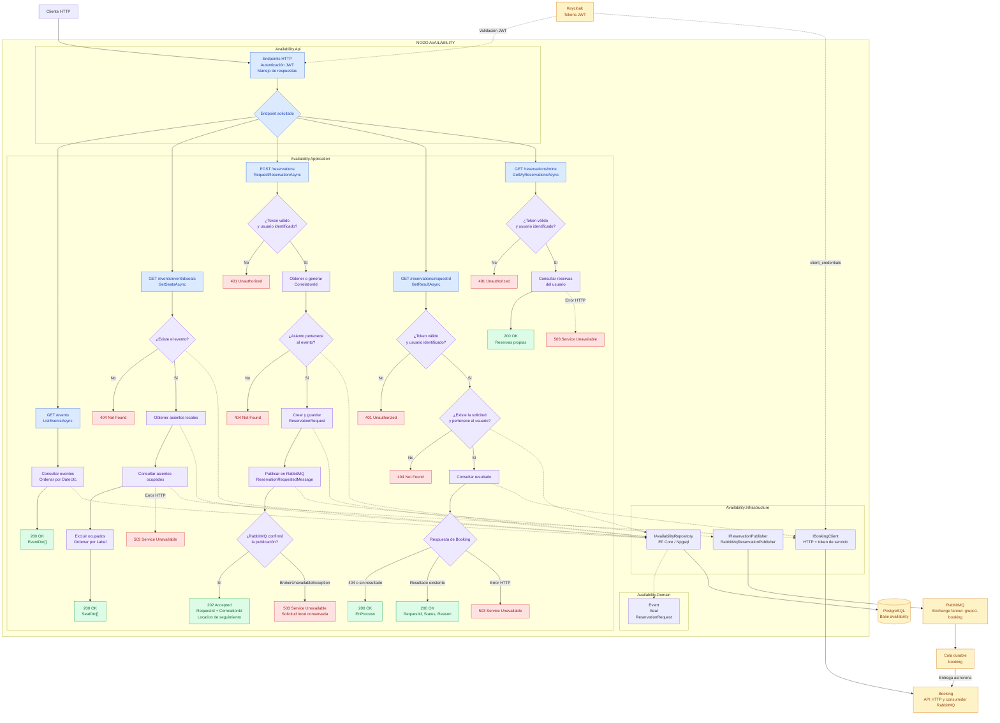

# Arquitectura de Availability

Availability permite consultar eventos y asientos disponibles, registrar solicitudes de reserva y consultar su resultado. Booking decide si el asiento puede reservarse y mantiene el estado de la reserva.

## Componentes y dependencias

El nodo sigue Clean Architecture: `Availability.Api` expone los endpoints; `Availability.Application` contiene `AvailabilityService`, que orquesta los casos de uso; `Availability.Domain` define las entidades de datos; y `Availability.Infrastructure` implementa la persistencia y las integraciones externas.

- **PostgreSQL:** la base propia `availability` almacena `Event`, `Seat` y `ReservationRequest`. No almacena la ocupación ni el estado de las reservas de Booking.
- **Booking:** se consulta por HTTP para obtener los asientos ocupados y el estado de una solicitud.
- **RabbitMQ:** Availability publica solicitudes en el exchange `grupo1-booking` (tipo `fanout`), que las envía a la cola durable `booking`. Las réplicas de Booking comparten esa cola y cada mensaje se entrega a una de ellas.
- **Keycloak:** emite los tokens de usuario y los tokens de servicio utilizados para llamar a Booking.

Availability no consume mensajes de resultado del broker. Consulta el estado en Booking cuando el usuario lo solicita.

## Guía de inicio

Se requiere .NET SDK 10 y Docker Desktop con PostgreSQL, Keycloak y RabbitMQ levantados. La conexión al broker se configura con `RabbitMq:Host`, `RabbitMq:Port`, `RabbitMq:User` y `RabbitMq:Password`; `appsettings.json` incluye los valores de desarrollo local. Para ejecutar la API localmente, también debe configurarse `ServiceAuth:ClientSecret` mediante user-secrets u otro proveedor de configuración. Para consultar asientos y resultados, Booking debe estar disponible en la URL configurada.

Availability y Booking declaran automáticamente el exchange, la cola y su enlace, además del exchange `grupo1-booking.dlx` y la cola de mensajes fallidos `booking.dead`. No hace falta crearlos manualmente.

Desde la carpeta `seat-reservation`, levantar los contenedores y ejecutar la API:

```powershell
docker compose up -d
dotnet run --project src/Availability/Availability.Api --urls http://localhost:5237
```

Al iniciar, la API aplica las migraciones de su base y, si no hay eventos, crea un evento de demostración con 20 asientos.

> La ejecución local mostrada usa el puerto 5237. Cuando se ejecuta con Docker Compose, Availability se publica en el puerto 5001.

## Autenticación y autorización

Las consultas de eventos y asientos son públicas. Crear una solicitud, consultar su resultado y listar las reservas propias requiere un token Bearer válido emitido por Keycloak. Availability verifica firma, emisor y vigencia; en la configuración actual no valida la audiencia (`aud`). No guarda contraseñas ni emite tokens.

El usuario se obtiene del claim `preferred_username` o, si no está presente, de `sub`. Si falta un token válido o no puede obtenerse el identificador del usuario, los endpoints protegidos responden **401 Unauthorized**. El usuario no se recibe en el cuerpo de la solicitud.

Para las dos consultas HTTP a Booking, Availability obtiene de Keycloak un token propio mediante `client_credentials`, identificándose como `availability-service`. El token se reutiliza hasta poco antes de vencer y se agrega a las llamadas salientes. Esto también ocurre cuando la consulta de asientos proviene de un usuario sin iniciar sesión.

## Resumen de endpoints

| Método | Ruta | Acceso | Función | Respuestas principales |
| --- | --- | --- | --- | --- |
| GET | `/events` | Público | Listar eventos. | 200 |
| GET | `/events/{eventId:guid}/seats` | Público | Listar asientos disponibles de un evento. | 200, 404, 503 |
| POST | `/reservations` | Autenticado | Registrar y publicar una solicitud de reserva. | 202, 401, 404, 503 |
| GET | `/reservations/{requestId:guid}` | Autenticado | Consultar el estado de una solicitud propia. | 200, 401, 404, 503 |
| GET | `/reservations/mine` | Autenticado | Listar las reservas del usuario autenticado. | 200, 401, 503 |

## Flujo de cada endpoint

### GET `/events`

La API llama a `AvailabilityService`, que consulta los eventos mediante el repositorio de la base local. Devuelve una lista de `EventDto` con `Id`, `Name` y `DateUtc`, ordenada por fecha.

Responde **200 OK**, incluso si la lista está vacía. No incluye asientos ni filtra eventos según su disponibilidad.

### GET `/events/{eventId:guid}/seats`

1. Verifica que el evento exista en la base local. Si no existe, responde **404 Not Found**.
2. Obtiene los asientos del evento desde la base local.
3. Consulta a Booking mediante `GET /events/{eventId}/occupied-seats`. Booking considera ocupados los asientos con reservas `Retenida` o `Confirmada`.
4. Excluye los ocupados y devuelve los disponibles, ordenados por etiqueta, como una lista de `SeatDto` con `Id` y `Label`.

Responde **200 OK** con la lista, incluso si no hay asientos disponibles (`[]`). Si la consulta a Booking propaga `HttpRequestException`, responde **503 Service Unavailable**.

Por la consistencia eventual, un asiento recién solicitado puede verse libre hasta que Booking procese la solicitud. La consulta no garantiza la reserva: si otro usuario obtiene el asiento primero, Booking rechaza la solicitud por `AsientoOcupado`.

### POST `/reservations`

Recibe un cuerpo con `EventId` y `SeatId`. El usuario se obtiene del token validado.

1. Toma `correlationId` del header `X-Correlation-Id` o genera uno si el header no está presente.
2. Registra el inicio en el log de auditoría y verifica en la base local que el asiento pertenezca al evento. Si no existe esa combinación, registra el resultado y responde **404 Not Found** con `{ "error": "El asiento no existe para ese evento" }`.
3. Crea y guarda un `ReservationRequest` con un identificador único (`RequestId`), evento, asiento, usuario y fecha UTC.
4. Publica un `ReservationRequestedMessage` en el exchange `grupo1-booking` de RabbitMQ con `RequestId`, `EventId`, `SeatId`, `UserId`, `RequestedAtUtc` y `CorrelationId`. El adaptador lo serializa como JSON, lo marca como persistente y asigna `MessageId = RequestId` y el `CorrelationId` del mensaje.
5. Cuando RabbitMQ confirma la publicación, registra el fin en el log de auditoría y responde **202 Accepted**, con la URL `/reservations/{requestId}` en `Location` y el cuerpo `{ requestId, correlationId }`.

Availability verifica la existencia del asiento, pero no consulta su ocupación ni lo retiene. Espera a que termine la publicación, sin esperar la decisión de Booking. **202 significa que la solicitud se registró y publicó; no que la reserva esté confirmada.**

Si la publicación lanza `BrokerUnavailableException`, responde **503 Service Unavailable**. Como la solicitud se guarda antes de publicar, puede quedar registrada sin que Booking la reciba. No hay Outbox ni recuperación automática de esas solicitudes por parte de la aplicación; una solicitud que no llegue a Booking puede seguir mostrándose como `EnProceso`. Repetir el POST genera otro `RequestId`: no reutiliza la solicitud anterior. La idempotencia de Booking por `RequestId` cubre mensajes repetidos de la misma solicitud.

### GET `/reservations/{requestId:guid}`

1. Busca la solicitud en la base local y verifica que pertenezca al usuario autenticado. Si no existe o es ajena, responde **404 Not Found**, sin consultar Booking.
2. Consulta a Booking mediante `GET /reservations/{requestId}`.
3. Si Booking devuelve 404, lo interpreta como una solicitud todavía no procesada y responde **200 OK** con `{ requestId, status: "EnProceso", reason: null }`.
4. Si Booking conoce la solicitud, responde **200 OK** con `{ requestId, status, reason }`. Los estados pueden ser `Retenida`, `Confirmada`, `Rechazada` o `Vencida`. Los motivos de rechazo pueden ser `AsientoOcupado`, `PagoFallido` o `PagoNoDisponible`; `reason` puede ser nulo.

La respuesta usa `ReservationResultDto` y no expone los campos adicionales de Booking, como `ReservationId` y `ExpiresAtUtc`. El estado no se almacena localmente: cada consulta válida de una solicitud propia vuelve a consultar Booking. Si se propaga `HttpRequestException`, responde **503 Service Unavailable**.

### GET `/reservations/mine`

Lista las reservas del usuario autenticado. No recibe parámetros ni cuerpo: el usuario se obtiene siempre del token validado, por lo que no es posible consultar las reservas de otra persona.

1. Obtiene el usuario del claim `preferred_username` o, si no está presente, de `sub`. Si no puede identificarlo, responde **401 Unauthorized**.
2. Invoca `AvailabilityService.GetMyReservationsAsync` con el identificador del usuario.
3. Responde **200 OK** con el resultado de esa operación.

Si la operación propaga `HttpRequestException` (Booking no responde), responde **503 Service Unavailable** en lugar de un error genérico. Al igual que en la consulta por `requestId`, no se informa un resultado parcial o inventado cuando Booking no está disponible.

La ruta fija `/reservations/mine` convive con `/reservations/{requestId:guid}` sin ambigüedad: la restricción `:guid` hace que `mine` nunca se interprete como un identificador de solicitud.

## Diagrama API Availability

