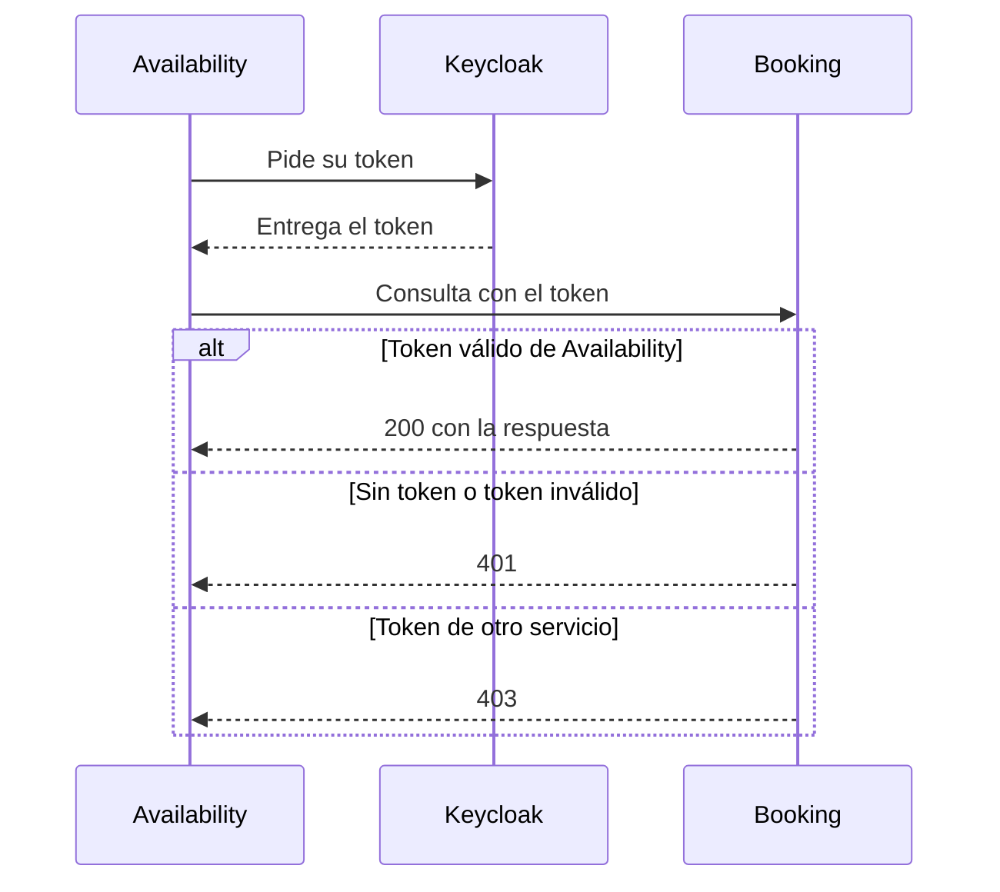
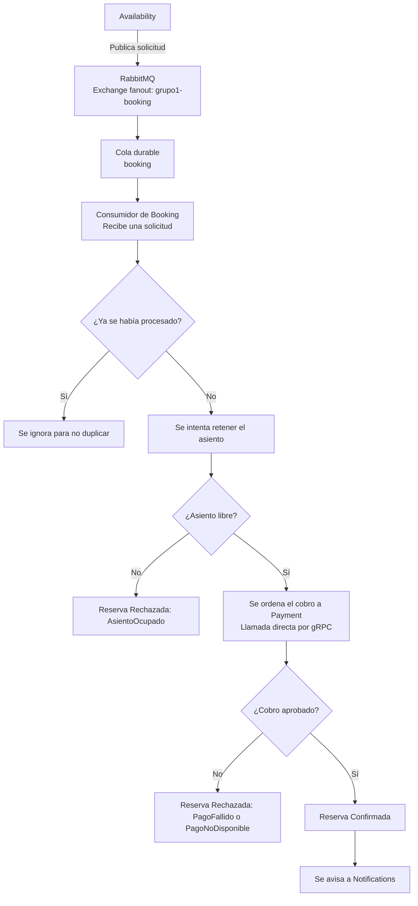

# Arquitectura de Booking

Booking recibe la solicitud generada por el cliente en Availability. Es el encargado de retener ese asiento y de ordenar a Payment que realice el cobro. Si el cobro se completa, debe devolver el estado de la reserva a Availability y enviar la orden a Notifications.

## Componentes y dependencias

- **PostgreSQL:** base de datos donde Booking guarda las reservas. Las tablas se crean o actualizan solas cada vez que Booking arranca.
- **RabbitMQ:** Availability publica las solicitudes en el exchange `grupo1-booking` (tipo `fanout`), que las envía a la cola durable `booking`. Las réplicas de Booking comparten esa cola y cada mensaje se entrega a una de ellas.
- **Keycloak:** servicio que identifica a cada sistema. Booking pide su token a Keycloak y también lo usa para comprobar quién le consulta.
- **Payment:** servicio que realiza el cobro de la reserva. Booking se comunica con él mediante gRPC.
- **Notifications:** servicio que avisa al usuario cuando su reserva queda confirmada. Booking se comunica con él por HTTP.

## Guía de inicio

Una vez que *Docker Desktop* esté levantado, abrimos una terminal parados sobre la raíz del proyecto y escribimos:

```powershell
dotnet run --project src/Booking/Booking.Api --urls http://localhost:5002/
```

### Configuración necesaria

Estos datos se encuentran en el archivo `appsettings.json` de Booking.Api:

| Dato | Para qué sirve | Valor de ejemplo |
| --- | --- | --- |
| Base de datos | Dónde se guardan las reservas | `localhost:5432` |
| RabbitMQ | Host y puerto del broker (`RabbitMq:Host` y `RabbitMq:Port`) | `localhost:5672` |
| Credenciales de RabbitMQ | Usuario y contraseña (`RabbitMq:User` y `RabbitMq:Password`) | `app` / `app` (desarrollo local) |
| Payment | Dirección del servicio de cobro | `http://localhost:5003` |
| Notifications | Dirección del servicio de avisos | `http://localhost:5004/` |
| Keycloak | Dirección del servicio de identificación | `http://localhost:8081` |
| Tiempo de retención | Cuánto se guarda el asiento mientras se cobra | 120 segundos |
| Precio del asiento | Monto fijo que se cobra por cada asiento | 500000 centavos |

Para ejecutar Booking localmente, hay que configurar su clave secreta de Keycloak (`ServiceAuth:ClientSecret`). Las credenciales de desarrollo de RabbitMQ ya están en `appsettings.json`.

El consumidor declara automáticamente el exchange, la cola y su enlace, además del exchange `grupo1-booking.dlx` y la cola de mensajes fallidos `booking.dead`. Availability declara la misma topología al publicar, por lo que no hace falta crearla manualmente.

## Autorización y Autenticación

Booking cumple dos roles:

- **Cuando llama a otros servicios:** se identifica ante *Keycloak* con el nombre `booking-service` y envía su token a Payment y a Notifications.
- **Cuando recibe consultas:** solamente acepta las que vienen de Availability. Cada consulta debe llevar el token de `availability-service`.



## Resumen de endpoints

| Método | Ruta | Acceso | Función | Respuestas principales |
| --- | --- | --- | --- | --- |
| GET | `/reservations/{requestId:guid}` | Solo Availability (con token) | Consulta el estado de una reserva | 200, 404, 401, 403 |
| GET | `/events/{eventId:guid}/occupied-seats` | Solo Availability (con token) | Consulta los asientos ocupados | 200, 401, 403 |

## Flujo de cada endpoint

### GET `/reservations/{requestId:guid}`

Con el requestId se consulta el estado de la reserva. En caso de que Booking todavía no haya procesado la solicitud, responde 404 y Availability se lo muestra al cliente como "En proceso".

Responde **200 OK** con los datos de la reserva, o **404 NOT FOUND** si todavía no existe.

Datos que devuelve:

| Dato | Significado |
| --- | --- |
| requestId | Número de la solicitud que hizo el cliente |
| reservationId | Número de la reserva creada por Booking |
| status | Estado de la reserva (por ejemplo: Retenida, Confirmada o Rechazada) |
| reason | Motivo, solo si fue rechazada |
| expiresAtUtc | Fecha y hora en que vence la retención del asiento |

Motivos posibles de rechazo:

- **AsientoOcupado:** otra persona ya tenía ese asiento.
- **PagoFallido:** Payment rechazó el cobro.
- **PagoNoDisponible:** Payment no pudo responder.

### GET `/events/{eventId:guid}/occupied-seats`

Se consulta un evento en específico con el eventId. Solamente devuelve los asientos ocupados, que se envían a Availability para que no los muestre al cliente o al frontend.

Responde **200 OK** con una lista de asientos.

## Cómo se procesa una solicitud de reserva

Además de los endpoints HTTP, Booking trabaja en segundo plano: consume las solicitudes de RabbitMQ desde la cola `booking`, de a una por réplica. Después llama directamente a Payment por gRPC para realizar el cobro.



Puntos importantes:

- **Sin duplicados:** si la misma solicitud llega dos veces, la segunda se ignora.
- **Confirmación y reintentos:** Booking confirma el mensaje a RabbitMQ después de procesarlo. Si el procesamiento falla, lo devuelve a la cola para reintentar.
- **Tiempo de retención:** el asiento se guarda 120 segundos mientras se cobra. Cada 10 segundos Booking revisa si hay reservas vencidas y las libera.
- **Si falla Notifications:** la reserva igual queda confirmada. El error solo se anota en el registro del sistema y no se reintenta el aviso.
- **Mensajes ilegibles:** si llega un mensaje que no se puede leer, se rechaza sin volver a encolarlo. RabbitMQ lo envía a la cola de mensajes fallidos `booking.dead` mediante el exchange `grupo1-booking.dlx`.
- **Pendiente conocido:** si la reserva vence mientras Payment está cobrando, el dinero no se devuelve de forma automática. Queda como mejora futura.
