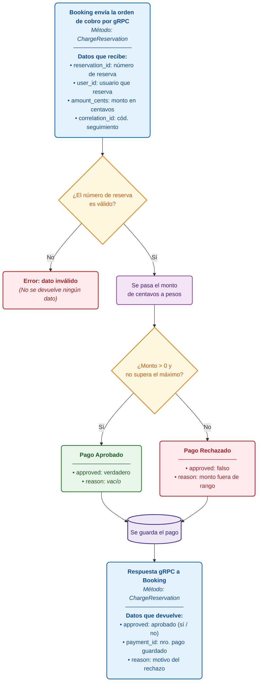

<!--Documentacion realizada por Facundo Varela e Isidro Ferrero-->
# Arquitectura de Payment

Payment es el servicio que realiza el cobro de una reserva. Recibe la orden de cobro de Booking, decide si el pago se aprueba o se rechaza, guarda el resultado y lo devuelve a Booking. El cobro es una **simulación**: no se usa dinero real ni una pasarela de pagos externa.

Booking recibe las solicitudes de reserva desde RabbitMQ y llama directamente a Payment por gRPC. La orden de cobro y su respuesta viajan por esa llamada gRPC; Payment no publica ni consume mensajes del broker.

## Guía de inicio

Una vez que *Docker Desktop* esté levantado, abrimos una terminal parados sobre la raíz del proyecto y escribimos:

```powershell
dotnet run --project src/Payment/Payment.Grpc --urls http://localhost:5003/
```

### Configuración necesaria

Estos datos se encuentran en el archivo `appsettings.json` de Payment.Grpc:

| Dato | Para qué sirve | Valor de ejemplo |
| --- | --- | --- |
| Base de datos | Dónde se guardan los pagos | `localhost:5432` |
| Monto máximo | Importe más alto que Payment aprueba | 100000 |
| Keycloak | Dirección del servicio de identificación | `http://localhost:8081` |
| Protocolo | Payment solo atiende llamadas gRPC (HTTP/2) | HTTP/2 |

Cuando se usa Docker, Payment **no se publica hacia afuera**: solo Booking puede llegar a él, por la red interna.

## Autorización y Autenticación

Payment solo acepta llamadas de Booking.

1. Booking se identifica ante *Keycloak* con el nombre `booking-service` y recibe un token.
2. Booking envía ese token junto con la orden de cobro.
3. Payment comprueba el token. Si no es de Booking, rechaza la llamada.

## Flujo del metodo *ChargeReservation*

Payment tiene un único método gRPC, llamado **ChargeReservation** (cobrar reserva).

### Datos que recibe

| Dato | Significado |
| --- | --- |
| reservation_id | Número de la reserva que se quiere cobrar |
| user_id | Usuario que hace la reserva |
| amount_cents | Monto a cobrar, expresado en centavos |
| correlation_id | Código para seguir una misma operación entre todos los servicios |

### Datos que devuelve

| Dato | Significado |
| --- | --- |
| approved | Indica si el cobro fue aprobado (sí o no) |
| payment_id | Número del pago registrado |
| reason | Motivo, solo si fue rechazado |

### Cómo se procesa el cobro



Puntos importantes:

- **Sin cobros repetidos:** si llega dos veces la orden de cobro de la misma reserva, Payment no cobra de nuevo y devuelve el resultado que ya había guardado.
- **Registro de auditoría:** Payment anota en el registro del sistema el inicio y el fin de cada cobro, junto con el `correlation_id`.
- **Respuestas posibles:** si el pago se rechaza, la respuesta es igualmente exitosa pero con `approved` en falso y el motivo. Solo se produce un error cuando el número de reserva no es válido.
- **Si Payment no responde:** Booking espera como máximo 5 segundos. Pasado ese tiempo, rechaza la reserva con el motivo "PagoNoDisponible".