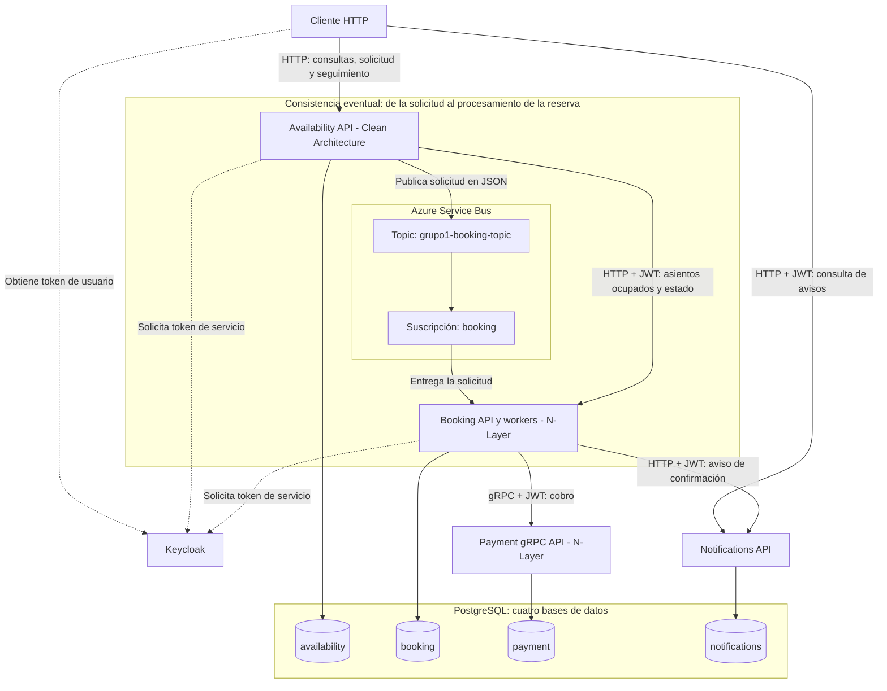

# Diagrama general

El sistema permite consultar asientos de un evento, solicitar una reserva y conocer su resultado. Está organizado en microservicios que se comunican mediante HTTP, gRPC y mensajes asíncronos. Cada servicio guarda sus datos en una base propia de PostgreSQL.

## 1. Arquitectura general

**Availability** recibe las consultas y solicitudes de reserva. **Booking** determina si puede reservarse el asiento y administra los estados. **Payment** procesa un cobro simulado y **Notifications** registra el aviso de una reserva confirmada y simula su envío mediante un log. **Keycloak** proporciona los tokens utilizados para autenticar a usuarios y servicios.

Availability publica las solicitudes en el topic `grupo1-booking-topic` de Azure Service Bus. Booking las recibe desde la suscripción `booking`. Para consultar ocupación y resultados, Availability también se comunica directamente con Booking por HTTP. Booking llama a Payment por gRPC y a Notifications por HTTP.

Las cuatro bases (`availability`, `booking`, `payment` y `notifications`) se encuentran en un mismo servidor PostgreSQL. El acceso a los datos se realiza mediante Entity Framework Core y Npgsql. La configuración Docker Compose contempla dos réplicas de Booking que procesan mensajes de la misma suscripción.

## 2. Cómo se procesa una reserva

1. **Consulta de asientos.** El cliente consulta los eventos y asientos disponibles a través de Availability. Estas consultas son públicas. Availability obtiene de Booking qué asientos están ocupados.
2. **Solicitud.** El usuario autenticado solicita un asiento. Availability comprueba que exista y pertenezca al evento, guarda la solicitud y publica un mensaje en Service Bus. Después responde con `202 Accepted` e identificadores para realizar el seguimiento.
3. **Retención.** Booking consume el mensaje. Si el asiento está libre, crea una reserva `Retenida`. Si ya está ocupado, registra el rechazo. La base de Booking tiene una restricción que evita guardar dos reservas activas para el mismo asiento y evento.
4. **Cobro.** Booking solicita a Payment el cobro simulado mediante gRPC. Payment guarda el resultado en su base de datos.
5. **Confirmación y aviso.** Si se aprueba el pago y la reserva sigue retenida, Booking la cambia a `Confirmada` e intenta enviar el aviso a Notifications. Este servicio guarda el aviso y registra un envío simulado en sus logs. Si el pago falla o no está disponible, Booking puede marcar la reserva como `Rechazada`.
6. **Seguimiento.** El cliente consulta a Availability para conocer el estado, que se obtiene desde Booking. Si Booking todavía no registró la reserva, Availability responde `EnProceso`.
7. **Vencimiento.** Las reservas retenidas tienen un vencimiento configurado de 120 segundos. Un proceso de Booking comprueba cada 10 segundos cuáles deben pasar a `Vencida`.

Los estados de una reserva son **Retenida, Confirmada, Rechazada y Vencida**. Un asiento se considera ocupado mientras su reserva esté retenida o confirmada. `EnProceso` es una respuesta de seguimiento de Availability, no un estado guardado de la reserva.

## 3. Consistencia eventual

La consistencia eventual se encuentra en el recorrido **Availability → Azure Service Bus → Booking**, señalado en el diagrama.

Availability guarda la solicitud y envía un mensaje, mientras que Booking la procesa posteriormente. Por eso puede existir un intervalo en el que Availability ya conoce la solicitud, pero Booking todavía no registró su resultado. El cliente recibe inicialmente una confirmación de recepción (`202 Accepted`) y consulta después el estado definitivo.

## 4. Autenticación y registro de operaciones

Keycloak gestiona los tokens JWT utilizados por el sistema. Las consultas públicas de eventos y asientos no requieren autenticación, mientras que solicitar una reserva y consultar su resultado sí la requieren. Availability y Booking utilizan tokens de servicio para comunicarse con las APIs protegidas; cada API valida los tokens y aplica sus políticas de autorización.

Los componentes utilizan un `CorrelationId` para relacionar los registros de una misma solicitud a lo largo del procesamiento. Esto permite seguir el recorrido de la reserva entre servicios.

La [tabla de componentes](tabla-componentes-1.md) resume la función y la justificación de cada elemento del diagrama.
