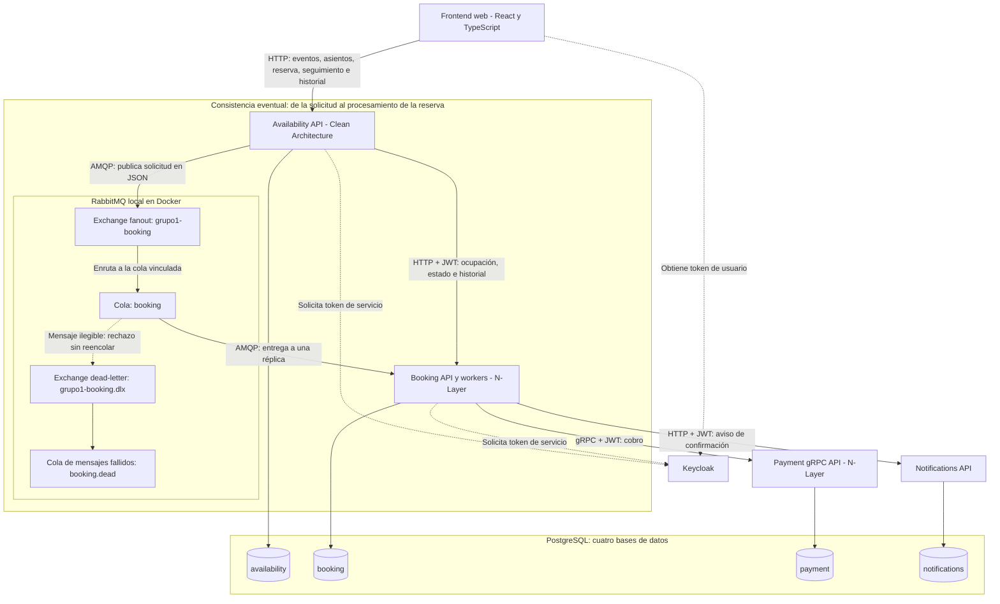

# Diagrama general

El sistema permite consultar asientos de un evento, solicitar una reserva y conocer su resultado. Está organizado en microservicios que se comunican mediante HTTP, gRPC y mensajes asíncronos. Cada servicio guarda sus datos en una base propia de PostgreSQL.

## 1. Arquitectura general

El **frontend**, desarrollado con React y TypeScript, permite consultar eventos y asientos, solicitar una reserva, seguir su resultado y ver el historial. Se comunica por HTTP con Availability y utiliza Keycloak para la autenticación.

**Availability** recibe las consultas y solicitudes de reserva. **Booking** determina si puede reservarse el asiento y administra los estados. **Payment** procesa un cobro simulado y **Notifications** registra el aviso de una reserva confirmada y simula su envío mediante un log. **Keycloak** proporciona los tokens utilizados para autenticar a usuarios y servicios.

Availability publica las solicitudes en JSON en el exchange de tipo `fanout` `grupo1-booking` de RabbitMQ. Este exchange las enruta a la cola `booking`, que consumen las réplicas de Booking. Para consultar ocupación, resultados e historial del usuario, Availability también se comunica directamente con Booking por HTTP. Booking llama a Payment por gRPC y a Notifications por HTTP.

RabbitMQ se ejecuta localmente mediante Docker Compose. Las conexiones de mensajería utilizan el puerto `5672` y su panel de administración está disponible en `http://localhost:15672`. Availability y Booking declaran la misma topología, cuyos nombres se definen en `src/Contracts/BrokerTopology.cs`.

Los exchanges y las colas se declaran durables, y Availability publica mensajes persistentes con confirmación del broker. Booking confirma la recepción del mensaje después de procesarlo; si ocurre una excepción durante el procesamiento, lo devuelve a la cola. Los mensajes que no pueden deserializarse se rechazan sin reencolarlos y RabbitMQ los deriva mediante el exchange `grupo1-booking.dlx` a la cola `booking.dead`. No hay un consumidor de esa cola implementado en el proyecto.

Las cuatro bases (`availability`, `booking`, `payment` y `notifications`) se encuentran en un mismo servidor PostgreSQL. El acceso a los datos se realiza mediante Entity Framework Core y Npgsql. La configuración Docker Compose contempla dos réplicas de Booking que consumen la misma cola `booking`: cada entrega se asigna a un consumidor, aunque un mensaje puede volver a entregarse si no se confirma su procesamiento.

## 2. Cómo se procesa una reserva

1. **Consulta de eventos y asientos.** El frontend consulta eventos y asientos a través de Availability, sin iniciar sesión. Availability obtiene de Booking cuáles están ocupados y devuelve todos los asientos con el campo `occupied`. El frontend distingue los disponibles y permite seleccionar los libres.
2. **Solicitud.** El usuario autenticado solicita un asiento. Availability comprueba que exista y pertenezca al evento, guarda la solicitud y publica un mensaje en el exchange `grupo1-booking` de RabbitMQ. Después de la confirmación del broker, responde con `202 Accepted` e identificadores para realizar el seguimiento.
3. **Retención.** Una réplica de Booking consume el mensaje desde la cola `booking`. Si el asiento está libre, crea una reserva `Retenida`. Si ya está ocupado, registra el rechazo. La base de Booking tiene una restricción que evita guardar dos reservas activas para el mismo asiento y evento.
4. **Cobro.** Booking solicita a Payment el cobro simulado mediante gRPC. Payment guarda el resultado en su base de datos.
5. **Confirmación y aviso.** Si se aprueba el pago y la reserva sigue retenida, Booking la cambia a `Confirmada` e intenta enviar el aviso a Notifications. Este servicio guarda el aviso y registra un envío simulado en sus logs. Si el pago falla o no está disponible, Booking puede marcar la reserva como `Rechazada`.
6. **Seguimiento.** El frontend consulta a Availability para conocer el estado de la solicitud, que se obtiene desde Booking. Si Booking todavía no registró la reserva, Availability responde `EnProceso`.
7. **Vencimiento.** Las reservas retenidas tienen un vencimiento configurado de 120 segundos. Un proceso de Booking comprueba cada 10 segundos cuáles deben pasar a `Vencida`.
8. **Historial.** La pantalla «Mis reservas» consulta `GET /reservations/mine` en Availability y permite filtrar por estado las reservas del usuario autenticado.

Los estados de una reserva son **Retenida, Confirmada, Rechazada y Vencida**. Un asiento se considera ocupado mientras su reserva esté retenida o confirmada. `EnProceso` es una respuesta de seguimiento de Availability, no un estado guardado de la reserva.

## 3. Consistencia eventual

La consistencia eventual se encuentra en el recorrido **Availability → RabbitMQ (exchange `grupo1-booking` → cola `booking`) → Booking**, señalado en el diagrama.

Availability guarda la solicitud y envía un mensaje, mientras que Booking la procesa posteriormente. Por eso puede existir un intervalo en el que Availability ya conoce la solicitud, pero Booking todavía no registró su resultado. El cliente recibe inicialmente una confirmación de recepción (`202 Accepted`) y consulta después el estado definitivo.

## 4. Autenticación y registro de operaciones

Keycloak gestiona los tokens JWT utilizados por el sistema. Las consultas públicas de eventos y asientos no requieren autenticación, mientras que solicitar una reserva y consultar su resultado o historial sí la requieren. El frontend envía el JWT en las solicitudes protegidas. Availability y Booking utilizan tokens de servicio para comunicarse con las APIs protegidas; cada API valida los tokens y aplica sus políticas de autorización.

Los componentes utilizan un `CorrelationId` para relacionar los registros de una misma solicitud a lo largo del procesamiento. Esto permite seguir el recorrido de la reserva entre servicios.

La [tabla de componentes](tabla-componentes.md) resume la función y la justificación de cada elemento del diagrama.
