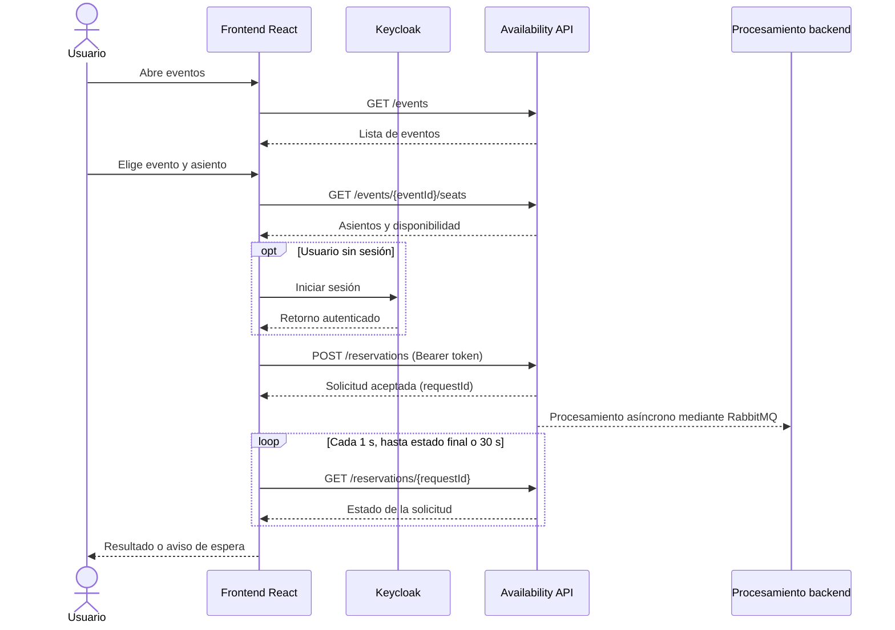

# Documentación técnica del frontend

## 1\. Descripción general

El frontend de **Seat Reservation** es una aplicación web desarrollada con **React, TypeScript y Vite**. Permite consultar eventos y sus asientos, iniciar una solicitud de reserva, seguir su estado y consultar las reservas del usuario autenticado.

La interfaz se comunica por HTTP con la API de **Availability**. No se conecta directamente con RabbitMQ, Booking, Payment ni Notifications: el procesamiento de la reserva ocurre en el backend y la interfaz consulta el resultado mediante la API.

## 2\. Tecnologías y organización

* **React:** construcción de las pantallas y componentes reutilizables.
* **TypeScript:** definición de tipos para eventos, asientos, reservas y respuestas de la API.
* **Vite:** servidor de desarrollo y generación de la versión de producción.
* **React Router:** navegación entre las pantallas.
* **keycloak-js:** inicio de sesión, cierre de sesión y administración del token de acceso.
* **CSS:** estilos y representación visual de asientos y estados.

La aplicación se organiza dentro de `frontend/src/`:

|Carpeta o archivo|Responsabilidad|
|-|-|
|`App.tsx`|Define las rutas y la estructura principal de navegación.|
|`main.tsx`|Inicializa Keycloak y monta la aplicación con `BrowserRouter` y `AuthProvider`.|
|`pages/`|Pantallas de eventos, selección de asientos, seguimiento y reservas del usuario.|
|`components/`|Elementos reutilizables: barra de navegación, asientos, estados y mensajes.|
|`auth/`|Configuración de Keycloak y contexto de autenticación.|
|`services/`|Solicitudes HTTP, contratos TypeScript y punto de acceso a la API.|
|`hooks/`|Carga asíncrona y consulta periódica del estado de una reserva.|
|`utils/`|Construcción de la grilla, formato de fechas y persistencia temporal de la selección.|
|`config.ts`|URL de la API, parámetros de Keycloak y tiempos de consulta.|
|`styles/index.css`|Estilos de la aplicación.|

## 3\. Pantallas y navegación

|Ruta|Pantalla|Función|
|-|-|-|
|`/`|`EventosPage`|Lista los eventos y calcula los asientos libres de cada uno.|
|`/events/:eventId`|`AsientosPage`|Muestra la grilla del evento, permite elegir un asiento e iniciar la reserva.|
|`/reservations/:requestId`|`ReservaPage`|Consulta y presenta el estado de una solicitud.|
|`/mis-reservas`|`MisReservasPage`|Muestra las reservas del usuario y permite filtrarlas por estado.|

`App.tsx` también contempla una vista de «Página no encontrada» para rutas no reconocidas.

### Eventos

`EventosPage` consulta el listado de eventos y, para cada uno, solicita sus asientos para calcular cuántos están libres. Si no se puede obtener el contador de un evento, este continúa apareciendo sin la cantidad de asientos disponibles.

### Selección de asientos

`AsientosPage` obtiene los asientos del evento y construye una grilla mediante `armarGrilla`. Los agrupa por la letra de la fila y los ordena numéricamente. La interfaz distingue asientos **libres**, **ocupados** y **seleccionados**; los ocupados no pueden seleccionarse.

Si el usuario todavía no inició sesión, la selección se guarda temporalmente en `sessionStorage` antes de redirigirlo a Keycloak. Al regresar, se recupera y se comprueba que el asiento siga libre. El botón de reserva se deshabilita mientras se envía la solicitud para evitar envíos repetidos por doble clic.

### Seguimiento de la reserva

`ReservaPage` presenta el estado mediante `EstadoBadge` y `PasosReserva`. El hook `useReservationStatus` consulta el backend **cada 1 segundo** hasta recibir un estado final (`Confirmada`, `Rechazada` o `Vencida`) o alcanzar un límite de **30 segundos**. Si se alcanza el límite, se informa al usuario que puede recargar la página para consultar nuevamente.

### Mis reservas

`MisReservasPage` obtiene las reservas asociadas al usuario autenticado y permite filtrarlas en el navegador por `Todas`, `Confirmada`, `Retenida`, `Rechazada` y `Vencida`. Cada registro enlaza a su detalle.

## 4\. Componentes y hooks reutilizables

|Elemento|Función|
|-|-|
|`Navbar`|Muestra el acceso a eventos, ingreso o salida de sesión y enlace a «Mis reservas».|
|`Asiento`|Representa un asiento de la grilla y controla su selección.|
|`EstadoBadge`|Muestra el estado de la reserva y, cuando corresponde, el motivo del rechazo.|
|`PasosReserva`|Representa visualmente las etapas de la solicitud.|
|`Cargando` / `ErrorMensaje`|Informan cargas, errores de autorización y fallas de conexión o servicio.|
|`useAsync`|Centraliza carga, error y reintento de solicitudes asíncronas.|
|`useReservationStatus`|Realiza la consulta periódica del estado de una solicitud.|

## 5\. Autenticación y autorización

La aplicación utiliza **Keycloak**, configurado en el realm `seat-reservation` y con el cliente `seat-web`. La inicialización emplea `check-sso`, por lo que es posible consultar eventos y asientos sin iniciar sesión. El flujo de autenticación utiliza **PKCE S256**.

`AuthProvider` expone el estado de sesión, el nombre del usuario y las operaciones de ingreso y salida. Antes de las solicitudes protegidas, `services/api.ts` intenta actualizar el token si vence en menos de 30 segundos y agrega `Authorization: Bearer <token>`.

El acceso mediante **Google** se configura como proveedor de identidad en Keycloak. La interfaz utiliza el mecanismo de autenticación de Keycloak; no implementa por separado el protocolo de Google.

## 6\. Comunicación con el backend

La URL base se obtiene de `VITE\_API\_URL`; si no se define, se utiliza `http://localhost:5001`.

|Método|Endpoint|Autenticación|Uso en el frontend|
|-|-|-|-|
|`GET`|`/events`|No|Consultar eventos.|
|`GET`|`/events/{eventId}/seats`|No|Consultar disponibilidad de asientos.|
|`POST`|`/reservations`|Sí|Crear una solicitud de reserva con `eventId` y `seatId`.|
|`GET`|`/reservations/{requestId}`|Sí|Consultar el estado de una solicitud.|
|`GET`|`/reservations/mine`|Sí|Obtener las reservas del usuario autenticado.|

La creación de una reserva devuelve un `requestId` y un `correlationId`. El frontend utiliza `requestId` para navegar a la pantalla de seguimiento. La aceptación inicial de la solicitud **no equivale a una reserva confirmada**: el resultado se obtiene posteriormente.

La capa `services/` centraliza las llamadas HTTP y los tipos de datos. Los errores se representan con un estado HTTP; el valor `0` identifica una falla de conexión. La interfaz distingue, entre otros, errores `401`, `404` y errores de servidor.

## 7\. Flujo de una reserva



El diagrama resume la interacción desde la perspectiva del frontend. El detalle del intercambio entre Availability, RabbitMQ, Booking, Payment y Notifications se documenta en los archivos de arquitectura del backend.

## 8\. Configuración y ejecución local

En `frontend/src/config.ts` se definen los siguientes valores:

|Parámetro|Valor predeterminado|
|-|-|
|`VITE_API_URL`|`http://localhost:5001`|
|`VITE_KEYCLOAK_URL`|`http://localhost:8081`|
|Realm de Keycloak|`seat-reservation`|
|Cliente de Keycloak|`seat-web`|
|Intervalo de consulta de reservas|1.000 ms|
|Límite de consulta de reservas|30.000 ms|

Desde la carpeta `frontend/`, los comandos disponibles en `package.json` son:

```bash
npm install
npm run dev
npm run build
npm run lint
```

El servidor de desarrollo de Vite está configurado para usar el puerto **5173**. Para que las funciones protegidas operen, Keycloak y la API deben estar accesibles y configurados para el origen del frontend.

## 9\. Consideraciones de implementación

* **Consulta pública y reserva autenticada:** la navegación inicial no exige sesión; crear y consultar reservas personales sí requiere un token.
* **Consistencia eventual:** el frontend no interpreta la respuesta inicial de creación como confirmación. Consulta el estado hasta obtener el resultado.
* **Disponibilidad cambiante:** el frontend muestra la disponibilidad de los asientos según la información obtenida de la API. Como esa disponibilidad puede cambiar mientras el usuario realiza la selección, el backend es el responsable de validar la reserva y resolver posibles conflictos de concurrencia.
* **Errores y reintentos:** las pantallas muestran mensajes de carga y error. La consulta del estado puede reintentarse ante fallas transitorias de conexión o del servidor.
* **Datos temporales de navegación:** el nombre del evento y la etiqueta del asiento pueden enviarse mediante el estado de navegación de React Router; esos datos pueden perderse al recargar la página, pero el identificador de solicitud permanece en la URL.

## 10\. Documentación relacionada

* [README principal](../README.md)
* [Diagrama general](diagrama-general.md)
* [Arquitectura de Availability](arq-availability.md)
* [Arquitectura de Booking](arq-booking.md)
* [Autenticación con Google y Keycloak](autenticacion-google-keycloak.md)
* [Cambio de broker a RabbitMQ](documentacion-cambio-broker.md)
* [Pruebas del frontend](frontend-tests.md)

