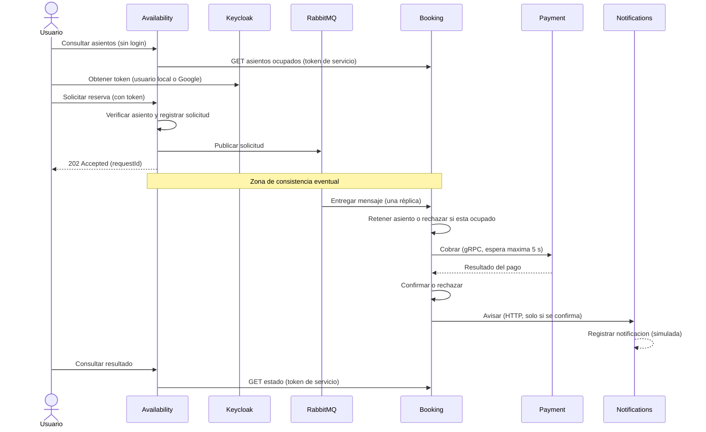
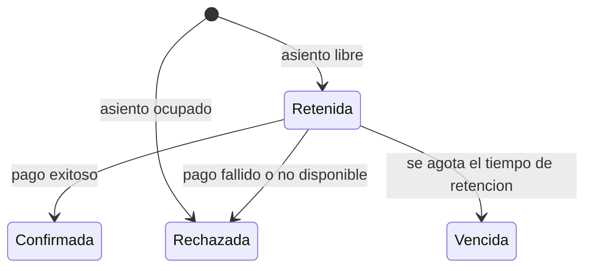
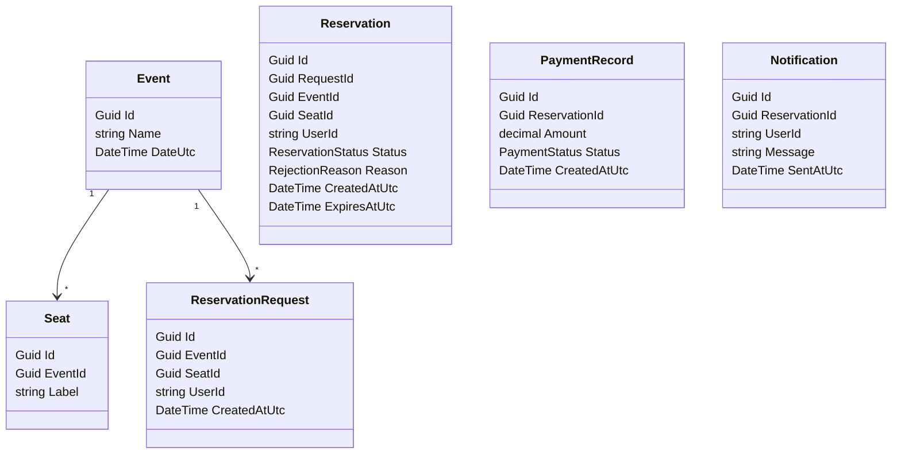

# Referencia del plan (fuente de verdad)

Todo lo que se documente o diagrame debe coincidir con este archivo.
Si algo del código necesita diferir, se actualiza acá primero.

> Actualizado tras migrar el broker de Azure Service Bus a RabbitMQ (decisión del equipo).
> Detalle del cambio en `documentacion-cambio-broker.md`.

## Servicios y puertos
| Servicio | Estilo | Puerto |
|---|---|---|
| Availability | Clean Architecture, dominio anémico | 5001 |
| Booking (REST + consumidor del broker) | N-Layer, dominio anémico | 5002 (en Docker, 2 réplicas: 5002-5003) |
| Payment (gRPC) | N-Layer, dominio anémico | 5003 (interno en Docker) |
| Notifications | API mínima REST | 5004 |
| Frontend | React + TypeScript + Vite, servido con nginx | 3000 |
| Keycloak | Servidor de autorización (realm `seat-reservation`) | 8081 |
| RabbitMQ | Broker (panel de administración) | 5672 (15672) |
| PostgreSQL | Una base por servicio | 5432 |

## Broker: RabbitMQ
- Exchange `grupo1-booking` (tipo `fanout`) y cola durable `booking`, compartida por las réplicas de Booking: cada mensaje se entrega a una sola.
- Mensajes ilegibles: exchange `grupo1-booking.dlx` y cola `booking.dead`.
- Availability publica; Booking consume. Availability y Booking declaran la topología al iniciar.
- Notifications NO usa el broker: Booking la llama por HTTP.

## Flujo de una reserva

## Estados de una reserva

Un asiento está ocupado mientras su reserva esté Retenida o Confirmada.
La retención dura 120 segundos y Booking revisa los vencimientos cada 10 segundos.
Mientras Booking no procesó la solicitud, Availability la muestra como `EnProceso` (estado intermedio, no es un estado de Booking).

## Endpoints
| Servicio | Endpoint | Acceso |
|---|---|---|
| Availability | `GET /events`, `GET /events/{id}/seats` | Público |
| Availability | `POST /reservations`, `GET /reservations/{requestId}`, `GET /reservations/mine` | Token de usuario |
| Booking | `GET /reservations/{requestId}`, `GET /events/{id}/occupied-seats`, `GET /reservations?userId=` | Solo `availability-service` |
| Payment | gRPC `ChargeReservation` | Solo `booking-service` |
| Notifications | `POST /notifications` | Solo `booking-service` |
| Notifications | `GET /notifications` (últimas 50) | Cualquier token válido |

Los eventos son tres y se cargan al iniciar Availability; no hay alta de eventos por API.

## Autenticación
- Keycloak emite los tokens; ningún servicio guarda contraseñas.
- Usuarios: client público `seat-web` (Authorization Code + PKCE) con usuarios locales `usuario1` y `usuario2`.
- Servicios entre sí: client credentials (`availability-service`, `booking-service`).
- Proveedor de identidad externo: Google (OIDC) a través de Keycloak. Es opcional y se carga con `scripts/configurar-google.ps1`; no está en el realm exportado.

## Entidades por servicio (dominio anémico: solo datos)

- Availability: Event, Seat, ReservationRequest
- Booking: Reservation (estados: Retenida, Confirmada, Rechazada, Vencida; motivos: AsientoOcupado, PagoFallido, PagoNoDisponible)
- Payment: PaymentRecord (estados: Aprobado, Rechazado)
- Notifications: Notification (índice único por ReservationId)

No hay relaciones entre entidades de servicios distintos: se vinculan solo por id (cada servicio tiene su propia base).

## Reglas de trabajo
1. Hacer `git pull` antes de empezar a trabajar.
2. Cada integrante trabaja en su área; los cambios a otra área se acuerdan antes.
3. Commits en español, con el formato `tipo: resumen`.
4. Cada integrante guarda sus prompts en `docs/prompts/NombreApellido.md`.
5. Si una duda cambia el plan, se consulta antes de documentar algo distinto.
6. Si cambia el plan, este archivo se actualiza antes que el código.